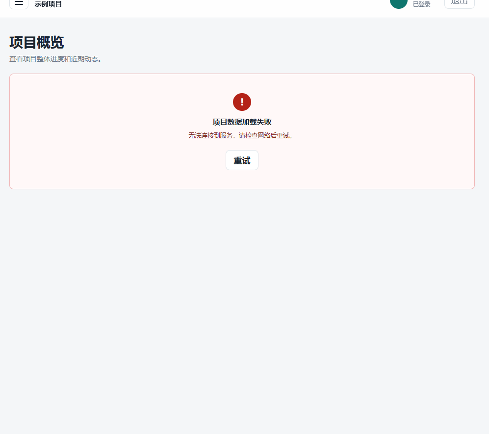

# P0-R1 复测记录：PR #15 桌面端

## 1. 轮次信息

| 项目 | 内容 |
|---|---|
| 检查轮次 | `P0-R1`（T-02 桌面端补测） |
| 执行时间 | `2026-10-11 15:11:19 +08:00` |
| 执行人 | `ChatGPT@root` |
| 检查提交 | `7724e1b3af514f97b6879d53e315f4eb46405219` |
| Pull Request | [PR #15](https://github.com/Xiang-Xiao-Yu/Student-Course-Project-Collaboration-and-Progress-Management-System/pull/15) |
| 需求 | `FR-01`、`AC-01`、`AC-10` |
| 结论 | PR #15 与 T-01 修复组合候选通过完整 P0 检查 |

## 2. 测试环境

```text
操作系统：Windows 10 Home China（版本 2009）
Node.js：v24.18.0
pnpm：11.21.0
Electron：v44.4.3
代码：PR #15，feat/frontend-p0，提交 7724e1b3af514f97b6879d53e315f4eb46405219
API 地址：http://127.0.0.1:1/api/v1（本轮故意使用不可连接的本机端口）
数据库：本轮桌面端验证不使用数据库
```

`pnpm test:p0-env` 原始输出：

```json
{
  "collectedAt": "2026-10-11T07:09:47.890Z",
  "node": "v24.18.0",
  "pnpm": "11.21.0",
  "expectedPackageManager": "pnpm@11.21.0",
  "packageManagerMatches": true,
  "gitCommit": "7724e1b3af514f97b6879d53e315f4eb46405219",
  "gitBranch": "",
  "platform": "win32",
  "architecture": "x64",
  "envPresence": {
    "DATABASE_URL": false,
    "JWT_SECRET": false,
    "ELECTRON_API_BASE_URL": false
  }
}
```

运行 Electron 时，单独给被测进程设置了不可用的 `ELECTRON_API_BASE_URL`；没有启动或修改 API 服务。

## 3. 检查步骤与结果

| 检查 | 结果 | 证据 |
|---|---|---|
| 锁定依赖安装 | 通过，`pnpm install --frozen-lockfile` 成功，锁文件未变 | 隔离工作目录 |
| 代码格式检查 | 通过，`pnpm lint` | 完整输出见下方 |
| TypeScript 检查 | 通过，`pnpm --filter @scpc/desktop typecheck` | 完整输出见下方 |
| 桌面端自动化测试 | 通过，6 个测试文件、21 项测试 | 完整输出见下方 |
| 桌面端构建 | 通过，Electron 主进程、预加载脚本和页面均构建完成 | 完整输出见下方 |
| 未登录访问项目页 | 通过，访问受保护页面后回到登录页 | 组合候选运行时原始结果 |
| 后台无法连接 | 通过，概览页实际请求 `/api/v1/health`，显示“项目数据加载失败”和“无法连接到服务，请检查网络后重试。” | 组合候选运行时原始结果 |
| 重试 | 通过，点击“重试”后又发出一次请求，失败提示再次显示 | 组合候选运行时原始结果 |
| 页面稳定与信息保护 | 通过，窗口保持打开；页面文字没有本机路径、堆栈、mock Token 或 Bearer Token | 组合候选运行时原始结果 |

### 运行时复测原始结果

```json
{
  "commit": "7724e1b3af514f97b6879d53e315f4eb46405219",
  "checks": {
    "apiTargetUnavailableBeforeLaunch": true,
    "unauthenticatedRouteRedirectedToLogin": true,
    "errorDisplayed": true,
    "requestCountBeforeRetry": 1,
    "requestPaths": [
      "http://127.0.0.1:1/api/v1/health"
    ],
    "retryTriggeredSecondRequest": true,
    "errorStillVisibleAfterRetry": true,
    "appRemainedOpen": true,
    "noSensitiveTextVisible": true,
    "visibleText": [
      "课",
      "课程项目协作台",
      "协作与进度管理",
      "当前项目",
      "示例项目",
      "工作区",
      "项目概览",
      "需求管理",
      "任务看板",
      "迭代计划",
      "会议纪要",
      "阶段验收",
      "项目管理",
      "统计与导出",
      "成员管理",
      "工作模式",
      "本机桌面端",
      "项目工作区",
      "示例项目",
      "演",
      "演示用户",
      "已登录",
      "退出",
      "项目概览",
      "查看项目整体进度和近期动态。",
      "!",
      "项目数据加载失败",
      "无法连接到服务，请检查网络后重试。",
      "重试"
    ]
  },
  "result": "PASS"
}
```

### 命令输出摘要

```text
pnpm --filter @scpc/desktop exec electron --version
v44.4.3

pnpm --filter @scpc/desktop typecheck
$ tsc -p tsconfig.json --noEmit

pnpm --filter @scpc/desktop test
Test Files  6 passed (6)
Tests       21 passed (21)

pnpm --filter @scpc/desktop build
主进程、预加载脚本和页面均构建成功。

pnpm lint
$ eslint . && prettier --check .
Checking formatting...
All matched files use Prettier code style!
```

首轮取证脚本没有及时记录请求次数；调整取证方式并等待重试后的页面更新后，最终运行结果如上。产品代码没有因此修改。

Electron 测试个人资料只用于本机运行，并由同目录 `.gitignore` 排除；没有创建数据库或保存真实凭据。

## 4. 证据文件

项目组长人工检查截图随本次 P0 验收记录提交；其他临时 Electron 运行资料仍留在本地并由 `.gitignore` 排除。

## 5. 结论与后续

- `root` 结论：T-01 启动错误脱敏修复与 PR #15 前端组合后的 P0 检查通过；未登录拦截、API 不可用提示、重试、健康检查、错误响应、数据库 Migration/Seed、构建与自动化测试均通过。
- 项目组长于 2026-10-11 确认 P0 验收通过；root 已正式解锁 P1。
- 项目组长复核：通过（2026-10-11，依据桌面端人工检查截图及确认）。

## 6. 修复前的 P0 全门禁结果（2026-10-11）

| 检查 | 结果 | 说明 |
|---|---|---|
| `pnpm install --frozen-lockfile` | 通过 | 锁文件未变 |
| `pnpm test:p0-env` | 通过 | Node `v24.18.0`、pnpm `11.21.0`，版本匹配 |
| `pnpm db:generate` | 通过 | 生成 Prisma Client `6.19.3` |
| `pnpm db:migrate` | 通过 | 在隔离工作区的新数据库应用 `20260927150705_init` |
| `pnpm db:seed` 连续两次 | 通过 | 两次均显示种子数据就绪 |
| `pnpm lint`、`pnpm typecheck`、`pnpm test`、`pnpm build` | 通过 | desktop 21 项、API 8 项、shared 6 项测试，共 35 项 |
| `pnpm test:p0-smoke` | 通过 | `/health` 返回 HTTP 200；不存在的路径按契约返回 HTTP 404 |
| 桌面端运行检查 | 通过 | 见本报告第 3 节和截图 |
| 缺少 `JWT_SECRET` 时启动 API | **失败** | 进程以状态码 1 退出并指出缺少配置，但输出含本机绝对路径和调用堆栈 |
| 无效数据库地址执行 Migration | 通过 | 失败原因可识别，输出未发现本机路径或调用堆栈 |

缺少 `JWT_SECRET` 检查的脱敏结果（原始输出只在进程内检查，没有保存堆栈或路径）：

```json
{
  "exitCode": 1,
  "timedOut": false,
  "missingSettingExplained": true,
  "absolutePathLeaked": true,
  "stackTraceLeaked": true,
  "placeholderLeaked": false,
  "testPassed": false
}
```

另有一次使用无效数据库地址启动 API 的探测在 20 秒内没有退出或输出数据库错误，因此不计为通过；无效地址 Migration 检查单独通过。所有数据库操作均在隔离工作区的新数据库中完成。

## 7. T-01 修复后的组合候选最终复测（2026-10-11）

| 检查 | 结果 | 实际结果 |
|---|---|---|
| 组合候选 | 通过 | 后端修复提交 `e6fc7183cf052994c5e6ebf9c94b000c072ec5de` + PR #15 head `7724e1b3af514f97b6879d53e315f4eb46405219` |
| 环境、依赖和数据库 | 通过 | `test:p0-env`、冻结安装、Prisma Client 生成、Migration、Seed 连续两次 |
| 静态检查与构建 | 通过 | lint、typecheck、build |
| 自动化测试 | 通过 | desktop 21 项、API 9 项、shared 6 项，共 36 项 |
| API 冒烟 | 通过 | 健康检查 HTTP 200；错误响应 HTTP 404 |
| 缺少 `JWT_SECRET` 启动 | 通过 | 进程以状态码 1 退出，说明缺少配置；输出未发现绝对路径、堆栈或占位密钥 |
| Electron 桌面运行 | 通过 | 未登录回到登录页；不可用 API 触发真实 `/api/v1/health` 请求并显示提示；重试再次请求；窗口未崩溃且页面未显示敏感信息 |

桌面运行原始结果：

~~~json
{
  "candidate": "e6fc7183cf052994c5e6ebf9c94b000c072ec5de + 7724e1b3af514f97b6879d53e315f4eb46405219",
  "apiTargetUnavailableBeforeLaunch": true,
  "unauthenticatedRouteRedirectedToLogin": true,
  "requestCountBeforeRetry": 1,
  "requestPath": "http://127.0.0.1:1/api/v1/health",
  "errorDisplayed": true,
  "retryTriggeredSecondRequest": true,
  "errorStillVisibleAfterRetry": true,
  "appRemainedOpen": true,
  "noSensitiveTextVisible": true,
  "result": "PASS"
}
~~~

## 8. PR #15 最终状态

- PR #15 最新 head：`7724e1b3af514f97b6879d53e315f4eb46405219`。
- 合并状态：`2026-10-11 16:24:52 +08:00` 以 squash 方式合并。
- 合并提交：`28d9e077b3875452e1ed477a4ad49260580b550c`；复核时远程 `main` 指向该提交。
- GitHub 没有报告自动检查结果，reviewDecision 为空；本报告记录了本地组合候选全量复测及最新 main 的再次复测。最终项目组长复核见第 10 节。

## 9. 最新 main 的全新复测（2026-10-11）

| 项目 | 结果 |
|---|---|
| 验证提交 | `28d9e077b3875452e1ed477a4ad49260580b550c`（PR #15 合并后的 main） |
| 本地分支 | `test/p0-r1-final-retest`，全新隔离工作区 |
| 环境 | Node `v24.18.0`、pnpm `11.21.0`、Windows x64 |
| 冻结安装 | 通过，`pnpm install --frozen-lockfile`，锁文件未变 |
| 环境采集 | 通过，`pnpm test:p0-env`，报告提交与分支正确且不输出凭据值 |
| Prisma | 通过，`pnpm db:generate`、`pnpm db:migrate`、`pnpm db:seed` 连续两次 |
| 代码检查 | 通过，`pnpm lint`、`pnpm typecheck` |
| 自动化测试 | 通过，`pnpm test`：桌面端 21 项、API 9 项、shared 6 项，共 36 项 |
| 构建 | 通过，`pnpm build` |
| API 契约 | 通过，`pnpm test:p0-smoke -- --json`：健康检查 HTTP 200，错误契约 HTTP 404 |
| 缺少 JWT_SECRET | 通过，专项进程级回归 1 项通过；非零退出、说明缺少配置，不输出绝对路径、堆栈或占位密钥 |
| 无效数据库配置 | 通过，Migration 非零退出并说明错误；输出不含绝对路径或调用堆栈 |
| Electron 版本 | `v44.4.3`；首次启动时本地二进制未就绪，执行锁定版本检查后下载完成，再次启动成功，未改源码或锁文件 |

### 项目组长的桌面人工检查

项目组长检查通过：页面只显示安全错误提示，未见本机路径、调用堆栈或 Token；应用保持可用，重试状态符合预期。截图证据：



## 10. 项目组长验收与阶段解锁

- 验收结论：项目组长于 `2026-10-11` 确认 P0-R1 通过。
- root 决定：P0 门禁通过，解锁 P1 用户认证阶段。
- P1 范围：T-01 执行认证 API，T-02 执行登录与个人资料界面；按各自任务文档的 P1.1～P1.3 和 `FR-01`、`AC-01` 实施。T-03 在两项任务完成并冻结后复测。
- P2 及后续阶段继续锁定，直至 P1 测试通过并由 root 再次解锁。
