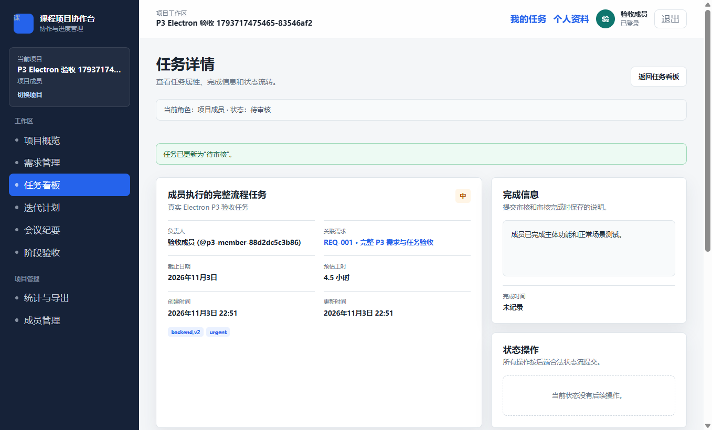
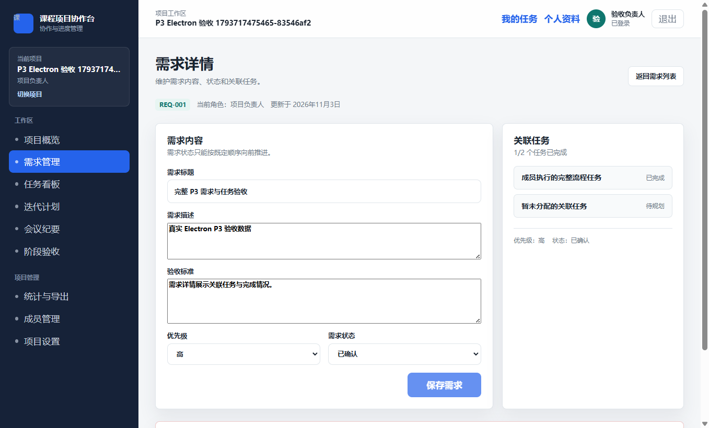
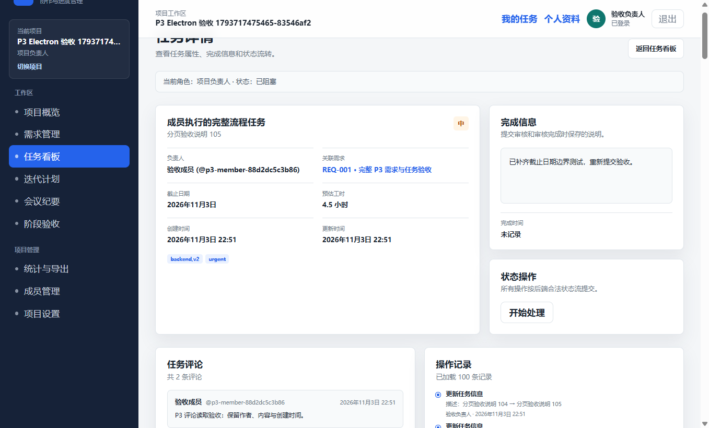

# P3 完整 Electron 阶段验收与 P4 解锁

## 门禁结论

**P3 阶段门禁通过，P4 已解锁。** 项目组长在本轮明确要求“继续做完整的 P3 Electron 阶段验收，有问题直接修复，通过后解锁 P4”。root 完成测试和独立证据复核后执行该授权，不再重复索取确认。

- 验收基线：`7f789e00df3e369145e3ce1ad88f15c1fe21ec91`，已包含 PR #36/#37。
- 需求：FR-04、FR-05、FR-07；AC-03、AC-04，关联 AC-08、AC-10。
- 执行日期：2026-11-03（Asia/Shanghai）；最终整轮 22:51:00–22:51:27。
- 负责人：ChatGPT@root；独立覆盖/证据复核：ChatGPT@p3-gate-audit；Electron 与 HTTP 工具分别由对应智能体编写并交 root 执行。
- 过程问题：[Issue #38](https://github.com/Xiang-Xiao-Yu/Student-Course-Project-Collaboration-and-Progress-Management-System/issues/38)。本轮没有发现必须修改业务实现的新缺陷；修正了运行环境与验收工具问题。

## 环境与真实性

| 项目 | 实际环境 |
|---|---|
| 操作系统 / CLI | Windows；Node.js 24.18.0；pnpm 11.21.0 |
| 桌面运行时 | Electron 44.4.3；Chromium 152.0.7977.130；内置 Node 24.21.0 |
| API / 数据库 | 实际构建后的 Nest API、Prisma 6.19.3、全新隔离 SQLite |
| 初始化 | 4 份已提交 Migration，经真实 `prisma migrate deploy` 全部成功 |
| 自动化驱动 | 复用本机 Playwright 1.64.1，未新增或升级项目依赖 |
| 故障模拟 | 仅中断或延迟真实请求以检查失败恢复；不伪造业务成功或权限响应 |
| 评论样本 | root 专用 Prisma fixture 仅向本轮隔离库写入两条目标评论及一条其他任务评论，验证已有只读接口与展示，不提前实现 P4 评论写入 |

测试账号、密码和令牌在运行时生成，验收工具在内存中持有凭据，JWT 密钥通过子进程环境传入；客户端会话沿用隔离 Electron profile 的 sessionStorage。报告及提交证据不含明文密码或令牌。运行库、Electron profile 与真实业务数据隔离，未读写已有业务数据库；最终证据不包含数据库或浏览器配置目录。

## 检查汇总

| 检查 | 结果 | 原始证据 |
|---|---|---|
| `pnpm test` | 326/326：API 200、desktop 120、shared 6 | [完整输出](p3-electron-gate-2026-11-03/test-output.txt) |
| `pnpm lint` | 通过 | [完整输出](p3-electron-gate-2026-11-03/lint-output.txt) |
| `pnpm typecheck` | 通过 | [完整输出](p3-electron-gate-2026-11-03/typecheck-output.txt) |
| `pnpm build` | API、Electron main/preload/renderer 构建通过 | [完整输出](p3-electron-gate-2026-11-03/build-output.txt) |
| 真实 Migration | 4/4，退出码 0 | [完整输出](p3-electron-gate-2026-11-03/migration-output.txt) |
| 真实 HTTP 验收 | 137/137，无 aborted | [逐项结果与请求记录](p3-electron-gate-2026-11-03/http/http-acceptance-1793717462470-ed2086.json) |
| 真实 Electron | 17/17 运行组，129 条断言、23 张截图，无跳过或未执行项 | [逐项结果](p3-electron-gate-2026-11-03/electron/results.json) |
| 独立证据复核 | 通过；无额外 renderer 异常，敏感值扫描 0 命中 | [执行汇总](p3-electron-gate-2026-11-03/summary.json) |

这些计数属于不同验证层，存在覆盖重叠，不相加作为唯一用例总数。退出码和子报告均由启动器核对，超时、失败、跳过、缺报告或未执行均不能判通过。

## Electron 场景与需求对应

| 组 | 场景 | 结果 |
|---|---|---|
| 01 | 固定版本 Electron 启动，真实注册/登录，隔离项目空状态与六列看板 | PASS |
| 02 | 负责人创建需求与验收标准、确认状态、标题 1/100/101 边界 | PASS |
| 03 | 多关联任务、无负责人、日期等于/早于项目开始日、工时和含逗号标签往返 | PASS |
| 04 | 实际鼠标非法 BACKLOG→IN_PROGRESS 与合法 BACKLOG→TODO；原生事件可信 | PASS |
| 05 | 普通成员开始、阻塞、恢复；空完成说明拒绝后提交审核 | PASS |
| 06 | 负责人空驳回理由校验、记录驳回理由，任务保留待审核 | PASS |
| 07 | 普通成员补充说明重新提交，清除旧驳回状态 | PASS |
| 08 | 负责人审核完成，完成时间存在；需求两关联任务显示 1/2，刷新后保持 | PASS |
| 09 | 已完成任务空重开原因拒绝；有效原因重开并清除完成时间 | PASS |
| 10 | 成员仅调整他人任务负责人，观察者界面严格只读 | PASS |
| 11 | 任务草稿关闭取消/确认，删除取消/确认 | PASS |
| 12 | 删除带未保存修改的需求后正常返回列表，无遗留弹窗 | PASS |
| 13 | 创建断网保留草稿、恢复后重试、请求期间离开保护 | PASS |
| 14 | 状态请求断网不改变任务，重试成功；请求期间编辑/关闭/其他任务操作互斥 | PASS |
| 15 | 成员/负责人完整状态历史，前后值/时间/对象可追溯；119 条真实活动完整分页 | PASS |
| 16 | 两条目标评论的作者/内容/时间可读，另一任务评论不混入 | PASS |
| 17 | 不存在详情提示，读取失败与重试，无未处理 renderer 异常 | PASS |

HTTP 层另外验证全部 8 条任务合法状态边、22 条非法跨状态边与 6 个同态请求，需求状态、CRUD、字段边界、成员权限、观察者写入拒绝、401/403/404、跨项目数据隔离、暂停禁止新增和归档只读。每次成功写入核对新增审计记录与旧记录保留；失败操作核对数据和活动记录不变。

复杂异步交错与字段校验同时由本轮单元/组件回归补强。真实 Electron 中的角色闭环由不同账号登录操作完成，不使用负责人替代成员。拖拽证据有 50 条 `isTrusted=true` 原生事件，两次均有 `dragstart`、`dragover`、目标 `drop` 和 `dragend`，未使用 `dispatchEvent` 代替实际拖拽。

## 关键截图







## 失败记录与处理

失败原始摘要、脚本输出及截图保存在 [failed-attempts](p3-electron-gate-2026-11-03/failed-attempts/)，未删除失败测试或降低业务断言。

| 运行标记 | 失败原因 | 处理与复核 |
|---|---|---|
| 1793716493065 | Electron 在工作树运行时目录中启动即 0x80000003，未进入页面 | 同一 SHA-256 二进制与临时 profile 在 Windows 本机临时目录正常运行；未改变产品和安全配置 |
| 1793716996038 | inline 错误文字使 `getByLabel(..., exact:true)` 无法定位 | 按 label 的标题 span 定位真实控件，保留所有字段值与校验断言 |
| 1793717157296 | 脚本把 DTO 长度错误预期为 422，实际契约为 400 | 按 P0 契约固定为 400，保留 `VALIDATION_FAILED`；业务日期校验仍为 422 |
| 1793717242533 | 默认 dragTo 跨横纵滚动后未触发目标 drop | 改用同视窗原生鼠标手势并记录可信事件；仍验证非法边与合法边 |
| 1793717460081 | 最终完整运行 | HTTP137/137、Electron17/17，所有子进程退出0且无超时 |

运行时 ZIP 由已安装锁定包的校验值验证：`790a355b684d5c7cc8dc3cdd8c4cca7c4b2d054685427c7554a956879a82e70b`。曾参考 [Electron 上游目录权限问题](https://github.com/electron/electron/issues/51761) 排查并试验本轮缓存的 RX 权限；该试验未解决问题，76 项原权限均已恢复。这里只确认运行目录/环境相关，未断言具体底层原因。

验收工具还修正了解码错误字符串的堆栈泄漏检查、旧 ActivityLog ID 保留检查；runner 等待输出关闭后完整脱敏，超时只终止本轮已知进程树，UI 启动即写检查点、崩溃记录 FAIL/NOT_RUN 并保留非零退出。独立扫描最终 11 个 JSON/TXT，JWT、Bearer 凭据、随机测试密码和运行密钥命中均为 0；7 条控制台错误对应预设断网/404/422 负例。

## 复跑方法

准备锁文件依赖、已生成 Prisma Client 与构建产物后运行：

```text
pnpm install --frozen-lockfile
pnpm db:generate
pnpm build
node tests/p3/run-electron-gate.mjs <playwright/package.json绝对路径> <已校验Electron44.4.3的electron.exe绝对路径>
```

本轮 `PRISMA_SCHEMA_ENGINE_BINARY` 指向已有同版本 6.19.3 本机引擎；常规完整安装可使用 Prisma 默认引擎。设置 `P3_GATE_BASE` 可把 `git rev-parse HEAD` 记入汇总。启动器自动生成新库、随机密钥、空闲端口和测试数据，运行结束关闭本轮 API/Electron；原始证据输出到忽略的 `tmp/ui-demo/p3-electron-gate-*`。不要把账号密码、令牌或数据库文件提交到仓库。

## P4 交接与边界

- T-01 解锁 P4.1～P4.4：迭代 CRUD/日期/任务加入移出/状态，组合统计，评论创建及本人修改删除，活动查询和脱敏。
- T-02 解锁 P4.1～P4.3：迭代页面与操作、统计及逾期标记、评论创建/编辑/删除入口与活动时间线。评论创建沿用既有 FR-07 和 T-01 P4.3，不是新增需求。
- T-03 解锁 P4.1～P4.3：FR-06/FR-07、AC-05 及对应权限、异常测试。P3 已有只读查询继续复用。
- P5 及以后仍锁定。本轮只完成验收与解锁，不提前实现 P4 功能，也不代表整个 MVP 已验收或发布。
- 本轮结果均为本机真实执行，不表述为远程 CI。主目录已有未提交内容保持原状；通过功能分支与 PR 交付。
- 需要回滚时以新的 revert PR 回滚验收工具/文档提交并重新冻结 P4，无业务数据迁移或历史重写。
