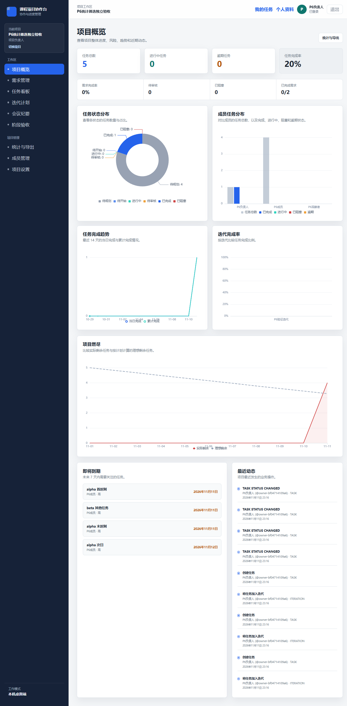
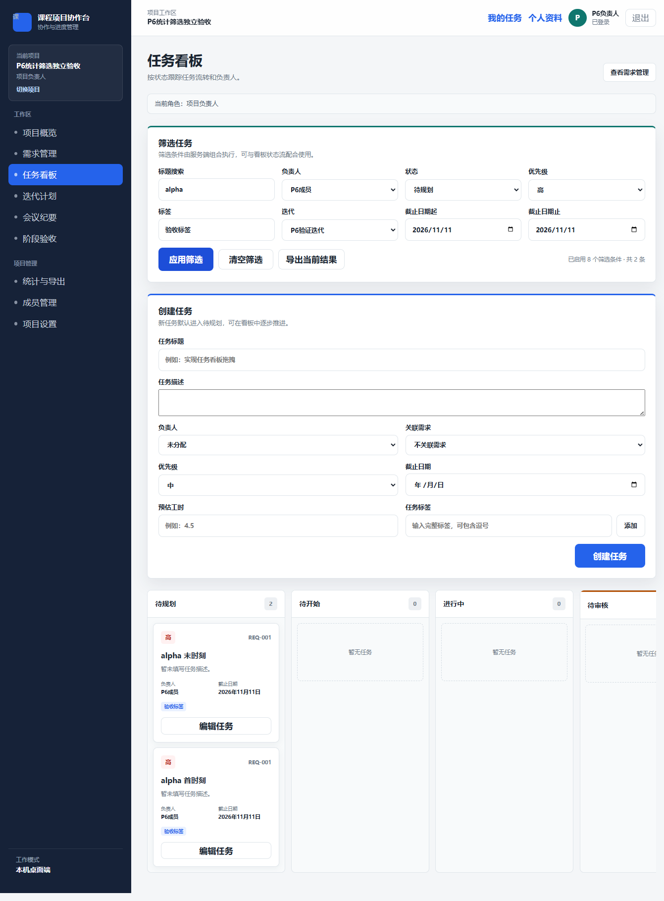

# P6 前端 PR #53 合并检查

- 检查者：ChatGPT@root；需求 FR-10/FR-11、AC-09/AC-10，并复核 AC-08 导出权限。
- 前端原始 head：`e677c550ce1f1c3fb7ec1d8b966d3492ae87255c`；后端基线：main `89f3f57346b7927b3630017baa17a703368fc1dc`，后端 #52 已合并。
- 范围：项目仪表盘、五种 ECharts 图表、任务组合筛选、需求标题搜索、任务 CSV 与项目进度报告。

## 检查与修复

初始代码审查及独立只读评审发现两个 P2：创建响应晚于筛选切换时会把旧任务插入新列表；同筛选的两次后台刷新逆序返回时会恢复旧任务状态。真实 Electron 在原合并预览复现 `beta` 结果混入 `alpha` 创建任务。

修复限 `BoardPage.tsx` 与其测试：活动筛选下仅使用服务端列表结果；mutation 成功后复用可取消的当前查询加载，由请求版本和 effect cleanup 拒绝旧响应。提交期间清空筛选或重试时，根据查询代际变化重新加载，包含提交与当前筛选均为空的情况。无筛选且没有新查询时继续使用原增量更新，创建与状态操作仍可并行。旧项目响应也不会写入新项目列表。

五项新增行为回归均观察到对应旧实现失败：切换筛选后的创建、同筛选刷新逆序、不匹配任务的中间状态、从活动筛选清空、从全部任务再次清空。最终看板 11/11 通过。独立只读复核最终修复后无剩余阻塞。

## 验证结果

| 验证 | 结果 |
| --- | --- |
| API Vitest | 36 文件，234/234 通过，含真实 SQLite/HTTP P6 集成测试 |
| Desktop Vitest | 49 文件，219/219 通过 |
| Shared Vitest | 6/6 通过 |
| AI 日志测试、布局 | 4/4 通过，布局检查通过 |
| 类型检查 | API、desktop、shared 均通过 |
| ESLint、Prettier | 均通过 |
| 构建 | API、shared、Electron 均通过 |
| 真实 Electron + Nest API + 隔离 SQLite | 12/12 通过，renderer 无未处理异常 |

检查执行器保存于项目原目录 `work/pr53-review-2026-11-11/checks.mjs`，通过当前 Node 直接执行项目既有 Vitest、TypeScript、ESLint、Prettier 和 electron-vite 工具；未安装或升级依赖。测试从各包目录执行，以遵守现有测试的工作目录假设。

主要验证命令：各包目录运行 `node node_modules/vitest/vitest.mjs run`（API/desktop）和根 Vitest 入口（shared）；根目录执行 `node --test tests/ai-logs/check-ai-log-layout.test.mjs`、`node scripts/check-ai-log-layout.mjs`、各包 `tsc -p <配置> --noEmit`、`node node_modules/eslint/bin/eslint.js .`、`node node_modules/prettier/bin/prettier.cjs --check .`。三包构建使用既有 TypeScript 与 electron-vite 入口；精确参数、目录和逐项输出保留在 `checks.mjs`、`check-results.json` 及对应 `.txt` 中。

桌面证据来自 `work/pr53-review-2026-11-11/run-1794410201816/` 的 `results.json`、截图、实际下载 CSV、隔离数据库和脱敏 API 输出。`results.json` 记录已测试源码 SHA-256；最终交付前核对其与提交源码一致。

12 项桌面运行组覆盖：五种图表和指标；八项筛选与上海日期首尾边界；当前结果真实 CSV 下载、BOM 和内容；清空、无结果与无效日期；需求字面搜索；导出失败后恢复和两类报告下载；Dashboard 网络失败与重试；空项目及删除最终任务后的历史保留；跨筛选迟到创建；同筛选并行操作及刷新逆序；清空查询在途时创建；成员/观察者导出隐藏、服务端 403 和非成员访问 404。

## 界面证据

## 限制与交付边界

- 非阻塞 P3：最近动态的动作名映射未完全覆盖后端真实 action，部分记录显示英文内部枚举；数据和权限未受影响。
- 未新增需求、API、数据库结构或依赖；无迁移要求。原工作区用户改动和所有历史证据保留。
- 本轮 P6 技术检查通过不代表解锁扩展功能、发布或部署。
- 回滚应通过新的 PR 撤销前端合并，保留已合并后端 #52；不重写远端历史，不删除分支或工作区。
