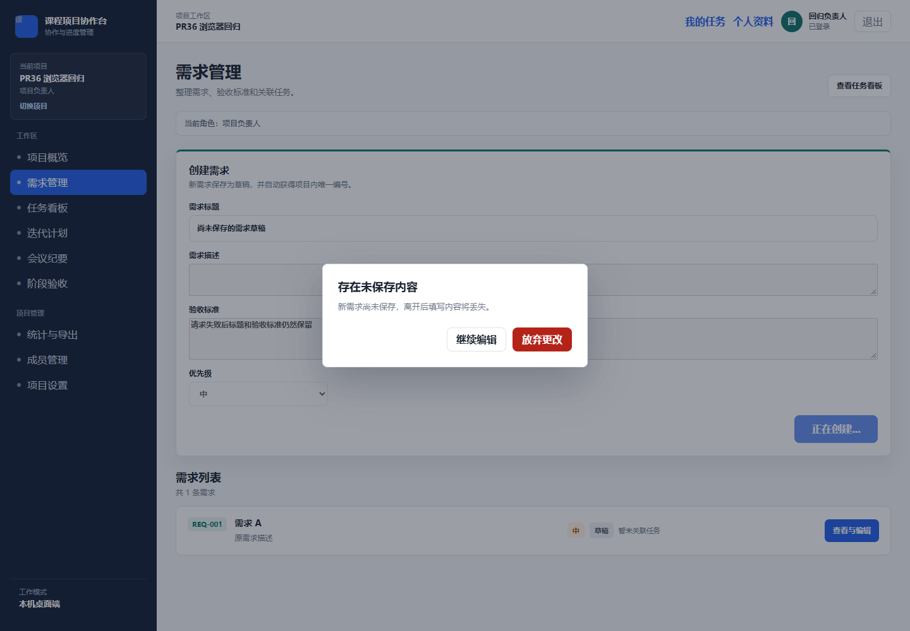
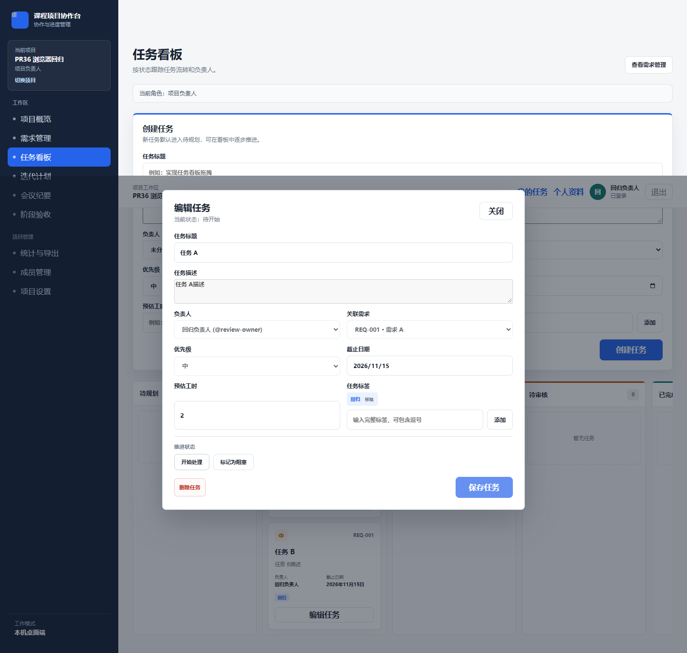
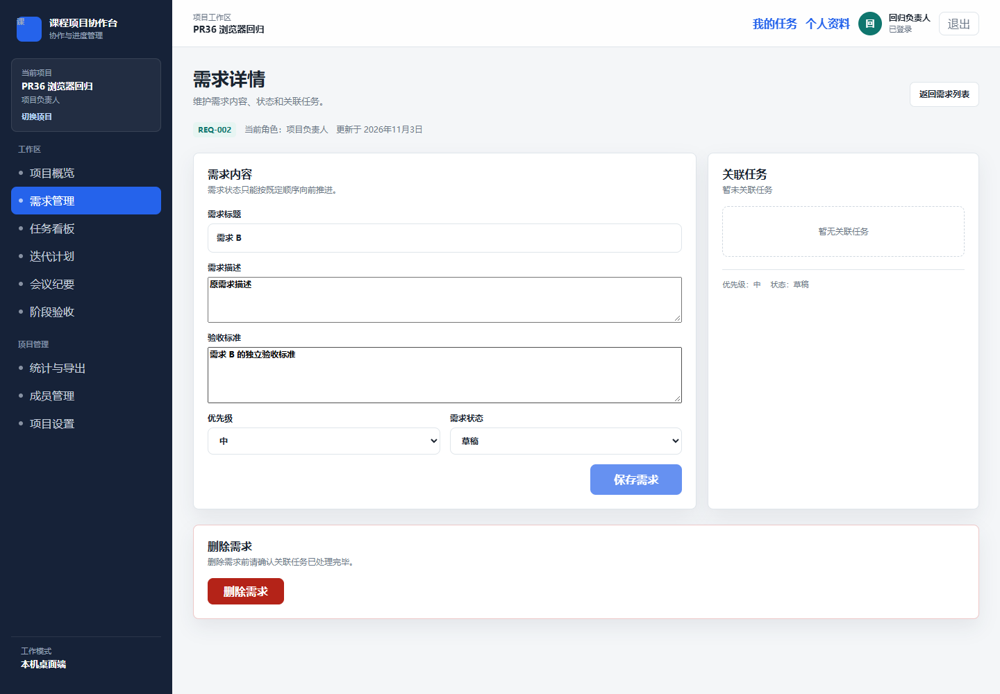

# PR #36 合并后审查与修复

- 日期：2026-11-03；负责人：ChatGPT@root。
- 用户要求：先合并 PR #36，再检查并修复问题。
- 原 PR：[#36](https://github.com/Xiang-Xiao-Yu/Student-Course-Project-Collaboration-and-Progress-Management-System/pull/36)，head `0487fb3`，合并提交 `49c3b72`。
- 需求范围：FR-04、FR-05、FR-07；AC-03、AC-04、AC-08、AC-10；需求 9.3 未保存表单提示。

## 已确认并修复的问题

| 问题 | 触发与影响 | 修复 |
|---|---|---|
| 创建需求期间草稿保护失效 | POST 未结束时离开不提示，失败后无法找回草稿 | 请求期间继续保留离开确认，失败保留内容 |
| 脏需求删除后被导航保护拦住 | 已删除对象仍留在页面，删除弹窗遮挡离开确认，可重复删除得到 404 | 删除成功关闭弹窗、解除保护，下一次 effect 返回列表 |
| 旧需求保存响应污染新页面 | A 保存后切到 B，或 A→B→A，旧成功/失败/finally 修改当前表单与忙碌状态 | 按项目、需求和页面版本隔离回调，切换时清理操作状态 |
| 看板并发任务操作互相覆盖 | 状态请求与编辑并行时旧 DTO 覆盖新内容，旧回调还能关闭另一个任务的草稿 | 编辑、删除、转交和状态更新互斥；独立创建任务仍可并行 |
| 关闭任务编辑器直接丢弃草稿 | 未保存时点关闭立即清空编辑状态 | 复用确认弹窗，取消保留草稿，确认才放弃 |

## 修改文件

- `apps/desktop/src/renderer/src/pages/RequirementsPage.tsx`、`RequirementDetailPage.tsx`、`BoardPage.tsx`：上述最小行为修复。
- 同目录 `RequirementsPage.test.tsx`、`BoardPage.test.tsx`：14 项持久回归测试，覆盖正常、边界、失败及异步交错。
- `apps/desktop/tests/pr36-review-browser.mjs`：参数化的真实浏览器回归脚本，复用外部现有 Playwright，不改依赖清单。
- 本报告、同名证据目录及本轮各智能体日志：审查与验证记录。

未修改 API 契约、需求基线、依赖、Prisma 或业务数据库。原主目录的未提交改动与交付文件保留，修复在独立 `fix/pr36-review` 分支完成。

## 验证结果

环境：Windows、Node.js 24.18.0、pnpm 11.21.0。依赖按既有锁文件离线恢复，Prisma Client 使用同版本本机引擎生成。

| 检查 | 结果 | 原始证据 |
|---|---|---|
| 合并后原始版本 `pnpm test` | 312/312（API 200、desktop 106、shared 6） | 本轮执行输出；作者曾报告的 startup-error 用例在标准命令下通过 |
| 需求页定向红→绿 | 原代码 6 失败/2 通过，修复后 8/8 | 需求审查智能体当日日志 |
| 看板定向红→绿 | 并发 3 项先失败、草稿确认 1 项先失败；最终 6/6 | 任务审查智能体当日日志 |
| `pnpm test` | 326/326（API 200、desktop 120、shared 6） | [完整输出](pr36-review-2026-11-03/test-output.txt) |
| `pnpm typecheck` | 通过 | [完整输出](pr36-review-2026-11-03/typecheck-output.txt) |
| `pnpm lint` | 通过 | [完整输出](pr36-review-2026-11-03/lint-output.txt) |
| `pnpm build` | API 与 Electron 构建通过 | [完整输出](pr36-review-2026-11-03/build-output.txt) |
| `git diff --check` | 通过 | 提交前复核 |
| 真实 Chrome + React + React Router | 7/7 | [请求记录与断言结果](pr36-review-2026-11-03/results.json) |

浏览器复现命令（路径参数指向本机已有文件，不新增项目依赖）：

```text
node apps/desktop/tests/pr36-review-browser.mjs <仓库绝对路径> <playwright/package.json绝对路径> <Chrome或Chromium可执行文件绝对路径>
```

浏览器覆盖：创建 pending 导航与失败草稿保留、脏需求删除返回列表、任务状态成功/失败解锁、任务草稿关闭确认、需求 A 保存后通过真实路由历史返回 B 的旧响应隔离、既有任务详情跨任务响应隔离。所有场景无页面异常；最后一组需求验证确认复用同一详情 DOM，而非刷新规避异步问题。

## 界面证据







其他截图与原始结果保存在同名证据目录。

## 审查、限制与回滚

- 需求与任务实现分别经独立审查；两位修复者交叉只读复核对方差异，root 复核代码、测试与实际界面结果，未发现本轮修复遗留的可证实阻断问题。
- 浏览器使用受控 API 响应以稳定重现网络交错；后端另由 200 项测试验证。本轮未重跑真实 Electron + SQLite 的完整 P3 验收，不能将 7/7 说成完整端到端验收。
- 初始受限运行环境发生临时文件及本机网络访问失败，在正常本机权限下复跑排除；浏览器脚本曾因隐式 label、外部 hash 导航和页面切换定位竞态失败，修正测试定位/真实路由历史后最终 7/7，未为通过测试削弱产品断言。
- PR #36 没有远程 CI 记录；本报告的测试结果均为本地运行结果。
- P3 阶段门禁与 P4 解锁仍按既有 T-03 流程执行，本次合并不自动解锁 P4。
- 修复不涉及迁移或依赖变化，可通过新的 revert PR 回滚本次修复提交；不重置或强推主分支。
