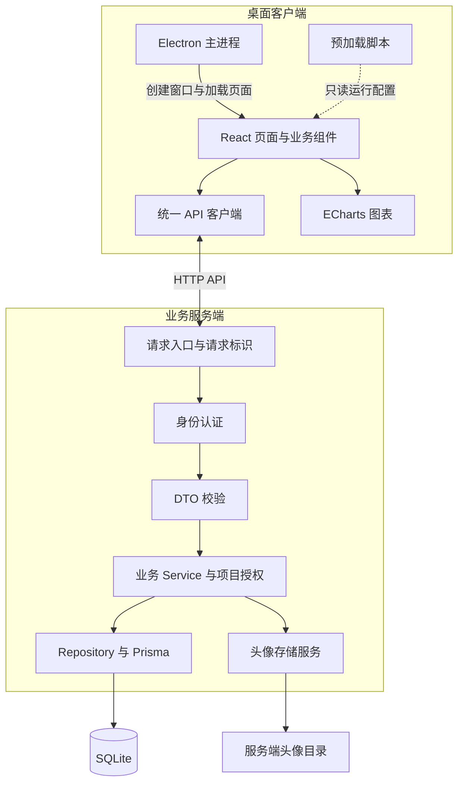
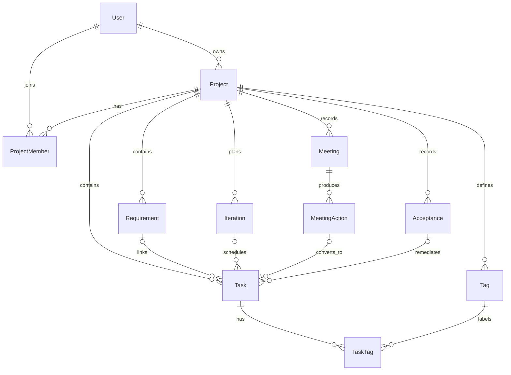
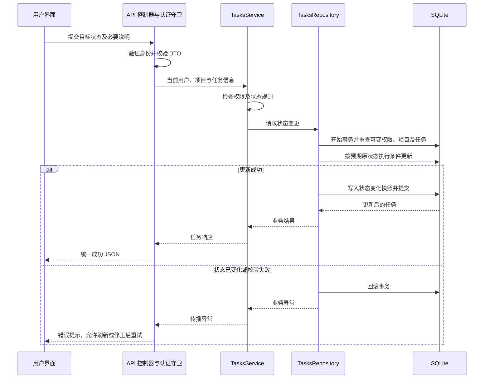
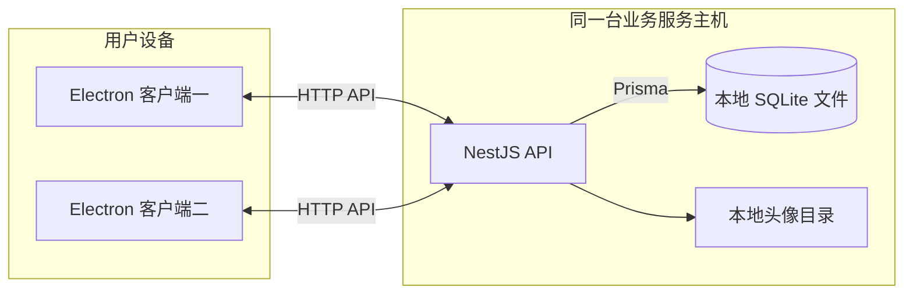

# 学生课程项目协作与进度管理系统技术架构书

| 项目     | 内容                                                                |
| -------- | ------------------------------------------------------------------- |
| 项目名称 | 学生课程项目协作与进度管理系统                                      |
| 文档名称 | 技术架构书                                                          |
| 文档版本 | 1.1                                                                 |
| 编写日期 | 2026 年 11 月 14 日                                                 |
| 编写单位 | 项目组                                                              |
| 面向读者 | 课程教师、开发人员、测试人员及后续维护人员                          |
| 需求基线 | 《软件需求规格说明书》0.1.4                                         |
| 实现基线 | main `0932ae2` 加2026-11-14技术收尾修复；精确产品散列见最终交付清单 |

## 本版更新

本版已核对管理员禁用、独立审计表、万任务分页、验收日期清空和Windows便携运行边界。架构说明配合最终测试与技术验收报告阅读。

本目录由原2026-11-12草稿修订，原D盘草稿保留。历史P0～P6记录仍绑定各自版本，不冒充本轮执行结果。

## 1. 文档概述

### 1.1 编写目的

本文档说明系统的技术组成、职责划分、数据组织、接口协作和部署方式，为项目成果说明、测试验收和后续维护提供技术依据。

文档以最终候选业务版本为架构基线，并依据需求规格说明书标明后续扩展边界。P7 的完整回归与最终验收结果由测试和验收文档记录，本文不将架构说明视为最终验收结论。

### 1.2 架构范围

系统核心覆盖 FR-01～FR-11：用户认证、项目与成员、需求、任务、迭代、评论与操作记录、会议、阶段验收、统计及基础导出。通用附件、GitHub Issue 关联、备份恢复和高级展示能力按 FR-12～FR-15 的既定优先级管理。

本文重点描述桌面客户端、业务 API、共享契约及数据存储。具体页面操作步骤由系统使用说明书承接，接口全量字段和测试执行结果分别由接口及测试文档承接。

## 2. 架构目标与约束

### 2.1 架构目标

1. 支持“项目创建 → 需求拆分 → 任务执行 → 成果审核 → 阶段验收 → 统计导出”的连续业务流程。
2. 明确客户端、服务端和数据库之间的职责，所有客户端通过统一 API 访问业务数据。
3. 将身份认证、项目授权、输入校验和业务状态规则落实到服务端。
4. 使业务变更和操作记录能够共同保存，支持过程追溯及历史统计。
5. 通过统一工程、类型约束和模块划分，便于三人团队协作及后续维护。

### 2.2 适用范围

首版面向 Windows 11 本机或局域网内的小型学生团队，目标用户量不超过 50 人，不依赖付费云服务。数据库由 API 服务端管理，客户端不能直接共享、打开或写入 SQLite 文件。

项目沿用 React、TypeScript、Electron、NestJS、Prisma、SQLite 和 ECharts 技术栈。实时协作、即时聊天、移动端、多组织 SaaS、GitHub 双向自动同步和面向公网的大规模部署不属于当前架构交付范围。

### 2.3 主要架构决策

| 决策                                     | 采用原因                                                       | 需要承担的约束                                   |
| ---------------------------------------- | -------------------------------------------------------------- | ------------------------------------------------ |
| 桌面客户端与集中式 API 分离              | 在一处实施业务规则、权限及数据管理，支持多个客户端访问同一项目 | 客户端执行核心业务时需要 API 可用                |
| 后端采用单个 NestJS 应用，按业务模块划分 | 与课程项目规模和团队分工相适应，减少部署组件并保留模块边界     | 模块共用一个服务进程，发布和资源使用需要整体管理 |
| Prisma 管理 SQLite                       | 利用关系模型、迁移及事务满足本机和小型局域网演示需求           | 需要关注并发写入、数据库锁及本地文件的数据保全   |
| 前后端采用 TypeScript 和共享契约         | 统一类型表达，便于核对状态、权限及接口约定                     | 静态类型不能代替服务端对真实输入的校验           |
| 服务端统计、客户端绘图                   | 图表和进度报告能够复用相同业务口径                             | 统计规模及历史事件量增加时仍需验证查询和聚合成本 |

## 3. 技术栈与工程组织

### 3.1 技术组成

下表中的依赖版本为实现基线中 `package.json` 的声明范围；可重复安装使用 `pnpm-lock.yaml` 锁定的解析结果，不以声明范围推断本机实际安装版本。

| 层次       | 技术及版本依据                                                | 主要用途                               |
| ---------- | ------------------------------------------------------------- | -------------------------------------- |
| 运行环境   | Node.js `>=24.18.0`；P0 约定基线为 `24.18.0`                  | 运行 API、构建和开发工具               |
| 包管理     | `pnpm@11.21.0`                                                | 管理 workspace、统一依赖与锁文件       |
| 开发语言   | TypeScript `^6.0.3`                                           | 提供静态类型及严格检查                 |
| 桌面运行时 | Electron `^44.4.3`                                            | 创建应用窗口并承载前端页面             |
| 用户界面   | React / React DOM `^19.3.0`                                   | 实现页面、表单和交互组件               |
| 页面路由   | React Router DOM `^7.18.4`                                    | 管理登录、账号及项目页面路由           |
| 构建工具   | electron-vite `^5.0.0`、Vite `^7.3.6`                         | 构建主进程、预加载脚本和渲染页面       |
| 可视化     | ECharts `^6.1.0`                                              | 展示任务分布、完成趋势及燃尽图         |
| 服务端     | NestJS Common / Core / Platform Express `^12.0.3`             | 提供模块化 HTTP API                    |
| 数据访问   | 根工程 Prisma `6.19.3`；API 的 Prisma Client 声明为 `^6.19.3` | 管理模型、迁移及数据库查询             |
| 数据存储   | SQLite；由 Prisma 数据源配置指定                              | 保存课程项目业务数据                   |
| 输入校验   | class-validator `^0.15.1`、class-transformer `^0.5.1`         | 校验及转换接口输入                     |
| 认证       | NestJS JWT `^12.0.2`、Node.js `crypto`                        | 签发访问令牌，执行密码哈希及比对       |
| 测试与规范 | Vitest `^5.0.1`、ESLint、Prettier、Node.js Test Runner        | 业务测试、静态检查、格式及日志布局检查 |

### 3.2 仓库组织

```text
apps/
  api/
    src/
      common/          统一响应、异常、请求标识、日期及导出工具
      config/          环境配置与启动校验
      health/          健康检查
      modules/         业务模块
      prisma/          Prisma 服务及生命周期管理
  desktop/
    src/
      main/            Electron 主进程
      preload/         受限运行配置桥接
      renderer/src/
        app/           路由与导航
        layouts/       项目及账号布局
        pages/         业务页面
        features/      按业务组织的接口、组件、类型和校验
        components/    通用组件及反馈组件
        lib/           API 客户端、运行配置及下载工具
packages/
  shared/src/contracts/  共享状态、权限、路由及响应约定
prisma/
  schema.prisma        数据模型
  migrations/          结构迁移
  seed.ts              开发种子入口
data/                  本地数据库及服务端头像文件
scripts/               工程及日志检查脚本
tests/                 跨模块检查
docs/                  需求、计划、测试及交付文档
```

根工程通过 pnpm workspace 管理 `apps/*` 和 `packages/*`。TypeScript 基础配置启用 `strict`、`noUncheckedIndexedAccess` 等检查，业务包使用各自的类型检查和测试入口。数据库文件与本地环境配置不作为源码提交。

## 4. 系统总体架构

### 4.1 逻辑架构

系统采用客户端与服务端分离的结构。Electron 提供桌面容器，React 页面发起 HTTP 请求，NestJS 处理认证、授权和业务规则，Repository 通过 Prisma 访问 SQLite。



身份守卫在进入控制器处理函数前执行，DTO 校验由全局 ValidationPipe 处理，Service 继续实施项目权限及业务规则。

### 4.2 职责与信任边界

| 组成       | 负责内容                                           | 边界                                       |
| ---------- | -------------------------------------------------- | ------------------------------------------ |
| 桌面客户端 | 展示、表单交互、看板操作、加载反馈、图表及下载     | 界面权限用于操作提示，业务授权由服务端裁决 |
| NestJS API | 身份认证、项目隔离、业务校验、数据变更、统计及导出 | 对客户端输入和对象关联重新校验             |
| 数据访问层 | 组织查询、事务及约束检查                           | 业务数据库访问统一经过 Prisma              |
| SQLite     | 持久化项目及过程数据                               | 文件由服务端管理，不向客户端共享           |
| 头像目录   | 保存经校验的头像内容                               | 只接受服务端生成的存储标识和受控路径       |
| 共享契约   | 提供状态、权限、路由及统一响应约定                 | 不能替代服务端运行时校验                   |

## 5. 桌面客户端架构

### 5.1 Electron 进程划分

主进程负责窗口创建、应用生命周期和页面加载。开发时加载开发服务器地址，构建后加载渲染页面文件。主窗口启用 `sandbox`、`contextIsolation` 和 `webSecurity`，关闭 `nodeIntegration`，禁止任意新窗口及页面级导航。

预加载脚本通过 `contextBridge` 暴露冻结的 `desktopRuntime` 对象，仅包含平台信息和 API 基地址。渲染页面通过统一 API 客户端直接请求后端；该版本没有向页面暴露任意文件读写、数据库访问或通用命令执行接口。

构建运行模式配置 Content Security Policy，限制脚本、连接和图片来源；开发服务器模式由开发环境处理，不将构建模式的策略视为所有运行模式共用配置。

### 5.2 页面与业务组织

客户端使用 `createHashRouter` 管理路由，以适应桌面文件页面入口。页面分为登录注册、个人账号和项目工作区三类，项目工作区按 `projectId` 组织。

| 页面组     | 主要页面                                           |
| ---------- | -------------------------------------------------- |
| 账号入口   | 登录、注册                                         |
| 个人账号   | 个人资料、我的任务                                 |
| 项目入口   | 项目中心                                           |
| 日常工作   | 项目概览、需求管理及详情、任务看板及详情、迭代计划 |
| 过程与验收 | 会议纪要、阶段验收                                 |
| 项目管理   | 统计与导出、成员管理、项目设置                     |

`pages/` 负责页面编排，`features/` 按业务封装 API 调用、类型、校验和专用组件，`components/` 提供通用表单反馈、确认、加载、错误及未保存内容提示。图表组件管理 ECharts 实例的创建、尺寸变化和销毁。

### 5.3 状态与异步请求

登录状态通过 SessionProvider 共享，页面使用 React hooks 管理表单、列表、当前选择和请求状态。会话包含访问令牌、过期时间及安全的用户摘要，保存于 `sessionStorage`；存储读取时检查结构和过期时间。

API 客户端统一添加认证头、识别响应格式、转换网络错误并处理 401。客户端会话存储不属于操作系统凭据保险库，不能据此声称令牌已加密保存。

任务筛选使用请求版本及筛选条件标识判断响应是否仍然有效，避免旧请求覆盖新结果。任务变更后的刷新遵循当前筛选；阶段验收中的创建、整改提交和记录切换使用操作锁及验收 ID 归属检查，保留失败后的恢复入口。

## 6. 服务端模块与分层

### 6.1 分层职责

| 层次                 | 主要职责                                                   |
| -------------------- | ---------------------------------------------------------- |
| Controller           | 声明 HTTP 路由，接收 DTO、当前用户和路径参数，调用 Service |
| DTO / ValidationPipe | 转换输入，校验类型、长度、格式及限定值，拒绝未声明字段     |
| Service              | 组织业务流程，检查权限、状态、日期和对象关联，构造业务响应 |
| Repository           | 通过 Prisma 完成数据查询、事务、条件更新和操作记录写入     |
| 公共设施             | 配置校验、请求标识、统一响应、异常转换、日期及 CSV 工具    |

AppModule 注册各业务模块、全局响应拦截器和异常过滤器，并应用请求标识中间件。服务入口设置 `/api/v1` 前缀、全局 ValidationPipe、允许来源列表及关闭钩子。

### 6.2 模块划分与需求映射

| 模块               | 主要职责                                         | 对应需求                          |
| ------------------ | ------------------------------------------------ | --------------------------------- |
| AuthModule         | 注册、登录、退出、密码哈希、令牌签发及认证守卫   | FR-01；AC-01                      |
| UsersModule        | 当前用户资料、头像上传、本人任务及密码修改入口   | FR-01；AC-11                      |
| ProjectsModule     | 项目、成员、角色、负责人移交、项目访问及活动记录 | FR-02、FR-03、FR-07；AC-02、AC-08 |
| RequirementsModule | 需求维护、状态、验收标准及关联任务               | FR-04；AC-03                      |
| TasksModule        | 任务维护、负责人、状态审核、标签、筛选和 CSV     | FR-05、FR-11；AC-04、AC-09        |
| IterationsModule   | 迭代计划、任务安排、关闭与统计                   | FR-06；AC-05                      |
| CommentsModule     | 需求、任务和会议评论，作者权限检查               | FR-07                             |
| MeetingsModule     | 会议、参会人、行动项及任务转换                   | FR-08；AC-06                      |
| AcceptancesModule  | 阶段验收、参与人员、结果和整改任务关联           | FR-09；AC-07                      |
| DashboardModule    | 项目统计、历史图表及基础进度报告                 | FR-10、FR-11；AC-09 及统计核对    |
| HealthModule       | 服务健康检查                                     | 工程运行检查                      |
| PrismaModule       | 提供统一 PrismaService                           | 数据访问公共设施                  |

AC-08 的权限控制和 AC-10 的异常处理贯穿所有相关模块，不归属于单一页面或控制器。

## 7. 数据架构

### 7.1 数据模型

实现基线包含 17 个 Prisma 模型。下表按业务关系列出全部模型，字段细节以该版本的 `prisma/schema.prisma` 为准。

| 模型                  | 核心内容及作用                                                     |
| --------------------- | ------------------------------------------------------------------ |
| User                  | 账号、密码哈希、昵称、头像引用、状态、令牌版本及平台管理员标识     |
| Project               | 名称、说明、起止日期、状态及负责人                                 |
| ProjectMember         | 项目与用户的成员关系、项目角色及加入时间                           |
| Requirement           | 项目内编号、描述、优先级、标准、状态及创建人                       |
| Task                  | 任务内容、负责人、状态、日期、工时、完成说明及需求、迭代、验收关联 |
| Tag                   | 项目内标签名称及颜色                                               |
| TaskTag               | 任务与标签的多对多关系                                             |
| Iteration             | 阶段目标、起止日期、状态及任务集合                                 |
| Comment               | 评论内容、作者及所属需求、任务或会议                               |
| ActivityLog           | 操作人、类型、对象、修改前后快照及时间                             |
| ProjectDeletionAudit  | 项目删除后的独立审计记录                                           |
| UserDisableAudit      | 平台管理员禁用用户的独立审计记录                                   |
| Meeting               | 会议主题、时间、议程、纪要及决定                                   |
| MeetingParticipant    | 会议与参会用户的多对多关系                                         |
| MeetingAction         | 行动项内容、负责人、截止日期、状态及转换任务引用                   |
| Acceptance            | 阶段、目标、标准、结果、原因、日期及整改任务集合                   |
| AcceptanceParticipant | 验收与参与用户的多对多关系                                         |

### 7.2 核心关系图

下图展示核心业务关系；评论、日志和参与人关联表的细节见模型清单。



任务可不关联需求、迭代或验收；关联后必须属于同一项目。行动项转换任务的引用具有唯一约束，配合事务中的条件更新避免重复转换。

### 7.3 一致性与索引

- `ProjectMember` 对项目和用户建立联合唯一约束，避免重复成员关系。
- 需求编号和标签名分别在项目内唯一；任务标签、会议参与人及验收参与人使用联合主键。
- 任务按项目与状态、负责人、需求、迭代、验收及截止日期建立相关索引；活动记录支持按项目和时间、对象查询。
- 状态、角色和优先级在该 SQLite Schema 中使用字符串字段，由 DTO 和 Service 按限定值校验，不能将注释中的取值说明视为数据库枚举约束。
- 外键根据对象关系使用 Cascade、SetNull 或 Restrict。成员移除不等于删除用户，已有评论及操作记录仍可追溯。

项目内 ActivityLog 会随项目删除而级联处理，因此 ProjectDeletionAudit 单独保存删除时的项目、操作者和时间快照，不依赖已删除项目的外键。

### 7.4 迁移管理

数据库结构由Prisma Schema和Migration管理，共5条迁移：初始化、认证会话、项目权限、项目删除审计、用户禁用审计。验收日期清空使用已有可空字段，不新增迁移。

本地 SQLite 和头像文件属于运行数据。涉及删除或不可逆数据变更时，应按项目流程评估备份与恢复；FR-14 的系统内备份恢复功能仍是建议扩展，不能将运维层面的数据保全等同于已实现该功能。

## 8. 接口与通信设计

### 8.1 通信方式

桌面页面通过 Fetch 调用 REST 风格 HTTP API，默认基地址为 `http://127.0.0.1:3000/api/v1`。受保护请求使用 Bearer 认证头。普通业务传递 JSON，头像上传使用 `multipart/form-data` 的 `avatar` 文件字段，CSV 使用单独下载流程。

`packages/shared/src/contracts/` 提供路由、响应、状态及权限约定。业务字段的运行时约束由 API DTO 和 Service 实施，客户端也保留相应的交互校验。

### 8.2 代表性接口

以下路径均位于 `/api/v1` 下，表中只列出代表接口，不代替完整接口说明。

| 方法        | 相对路径                                                             | 用途                     |
| ----------- | -------------------------------------------------------------------- | ------------------------ |
| GET         | `/health`                                                            | 公开健康检查             |
| POST        | `/auth/register`、`/auth/login`、`/auth/logout`                      | 注册、登录和退出         |
| GET / PATCH | `/users/me`                                                          | 查看或修改当前用户资料   |
| POST        | `/users/me/avatar`                                                   | 上传当前用户头像         |
| PATCH       | `/users/me/password`                                                 | 修改密码并更新令牌       |
| GET / POST  | `/projects`                                                          | 查询或创建项目           |
| GET / POST  | `/projects/:projectId/requirements`                                  | 查询或创建需求           |
| GET / POST  | `/projects/:projectId/tasks`                                         | 查询或创建任务           |
| PATCH       | `/projects/:projectId/tasks/:taskId/status`                          | 流转、审核或重新打开任务 |
| POST        | `/projects/:projectId/meetings/:meetingId/actions/:actionId/convert` | 将行动项转换为任务       |
| GET / POST  | `/projects/:projectId/acceptances`                                   | 查询或创建阶段验收       |
| GET         | `/projects/:projectId/dashboard`                                     | 获取项目统计及图表数据   |
| GET         | `/projects/:projectId/tasks/export`                                  | 按任务筛选条件导出 CSV   |
| GET         | `/projects/:projectId/reports/progress`                              | 导出基础项目进度 CSV     |

### 8.3 统一响应与异常

普通接口的成功响应采用以下结构：

```json
{
  "success": true,
  "data": {
    "id": "task-id",
    "status": "IN_PROGRESS"
  },
  "meta": {
    "requestId": "request-id",
    "timestamp": "2026-11-12T00:00:00.000Z"
  }
}
```

失败响应包含 `success: false`、`error.code`、`error.message`、`error.details` 和相同的 `meta`。稳定错误码用于程序分支判断，中文消息用于展示。HTTP 状态区分参数错误、未认证、无权限、不存在、冲突、业务校验失败及服务异常。

全局异常过滤器将未识别异常转为安全的通用错误，不直接向客户端回显内部异常。请求标识用于定位一次调用，不承载凭据或业务隐私。

### 8.4 CSV 响应特例

任务和进度报告导出使用 `RawResponse` 跳过成功 JSON 包装，直接返回 `text/csv; charset=utf-8`，设置附件文件名及 `Cache-Control: no-store`。错误仍走统一异常响应，不将错误 JSON 当成文件下载。

CSV 输出包含 UTF-8 BOM，使用 CRLF 行结束符和双引号转义，并对以 `= + - @`、制表或回车开头的单元格进行公式防护。客户端先检查状态和内容类型，再将 Blob 交给下载工具。导出权限由服务端单独检查。

## 9. 关键业务流程与事务设计

### 9.1 任务状态流转

任务状态由服务端限定：待规划进入待开始，待开始进入进行中或已阻塞，进行中进入待审核或已阻塞，待审核经负责人审核后完成；已阻塞可恢复进行中，已完成可按规则重新打开。



`withProjectWrite` 在事务内重新检查账号状态、成员权限和项目状态。任务状态更新以原状态为条件，避免陈旧页面直接覆盖并发变化。完成时间和操作记录随变更保存；审核不通过时保持待审核并记录原因，重新打开时要求原因。

这些机制针对具体业务冲突，不代表系统具有通用离线合并或所有请求的幂等保障。

### 9.2 行动项转换任务

转换在一个数据库事务中完成：检查行动项尚未转换，验证负责人、日期和需求归属，创建任务，再以 `convertedTaskId` 仍为空为条件更新行动项，并保存任务创建和转换日志。条件占用失败时事务回滚，不留下该次转换新建的孤立任务。

单次转换的原子范围不包含转换后在其他接口执行的所有后续操作。若还要把任务加入迭代，客户端应保留已创建任务的信息，后续失败时恢复或重试相应步骤。

### 9.3 阶段验收与整改

验收记录由 AcceptancesModule 管理，参与人使用独立关联表，整改任务通过 Task 的 `acceptanceId` 关联验收，可同时关联需求及迭代。

整改任务创建与加入迭代可能分为多次接口调用。前端保存待处理任务及验收归属，限制冲突操作和切换，后续步骤失败时提供重试，避免将已有任务误归属到另一条验收记录。

### 9.4 项目删除审计

项目删除受到权限及确认校验约束。删除过程保存独立审计快照，并按模型关系处理项目内业务数据。项目内普通操作记录与删除后的审计记录承担不同职责，不能依赖已被级联删除的记录证明删除行为。

## 10. 认证、授权与文件安全

### 10.1 身份与会话

密码使用 Node.js `scrypt`、随机盐及恒定时间比较完成哈希和校验。登录后由服务端签发 JWT，认证守卫检查签名、有效性、载荷结构、账号状态及数据库中的 `tokenVersion`。

退出登录通过增加账号的令牌版本使原版本令牌失效，因此会影响该账号使用原版本令牌的其他会话。修改密码也会轮换版本，并为当前操作返回新令牌。客户端删除会话只是本地处理，不能替代服务端失效机制。

### 10.2 项目授权与隔离

平台管理员由 User 的 `isPlatformAdmin` 标识；项目角色为 OWNER、MEMBER、OBSERVER。ProjectAccessService 根据用户、项目、成员关系和操作权限生成访问上下文。非成员访问项目时返回“不存在或无权访问”，避免暴露项目存在性。

所有关联对象都应核对项目归属。关键写入在事务内重新检查可变条件，观察者只读，成员不能代替负责人执行审核完成、角色管理及阶段验收等管理操作。归档项目禁止业务写入，暂停项目禁止新增业务数据；暂停不等于所有既有数据都只读。

### 10.3 头像存储

头像单文件上限为 10 MiB，支持 JPEG/JPG、PNG 和 WebP。服务端依据文件签名检查实际格式，并核对文件长度及声明 MIME；这属于内容签名校验，不等同于完整图像解码验证。

文件存放于服务端 `data/avatars` 下的用户目录，文件名由服务端 UUID 生成，数据库保存 `uploaded:` 存储引用。文件先写入临时位置再重命名；资料更新采用旧头像引用作为比较条件，冲突或失败时清理该次新文件并保留原引用。

文件系统与数据库通过补偿流程衔接，不属于同一个数据库事务；文件清理失败等残留情况需由后续维护处理。

读取用户资料或相关成员信息时，服务端可将受控文件转换为 Data URL 返回，客户端不获得服务端绝对路径。通用附件模块按 FR-12 单独规划，不能将头像机制视为通用附件管理已实现。

### 10.4 配置与运行边界

密钥从环境变量读取，本地 `.env` 不提交。输入采用白名单校验，查询使用 Prisma；标题字面搜索所用 SQL 通过 Prisma 参数化模板执行，不拼接用户输入。

默认连接为本机 HTTP，当前架构不包含公网 HTTPS 入口、证书管理或公网身份平台。CORS 和桌面 CSP 限制来源与运行能力，不能替代传输加密或服务端授权。

## 11. 统计、筛选与历史数据设计

### 11.1 统计数据来源

DashboardRepository 使用事务读取任务、需求、迭代、成员、最近活动和任务状态事件。项目完成率、任务状态分布和迭代任务统计从同一批任务数据计算，避免分别读取任务与迭代数据时出现口径矛盾。

当前汇总只统计现存任务；完成趋势和燃尽图结合状态事件及删除快照重建历史。任务重新打开或删除，不直接抹去此前的完成事件。此设计利用操作记录进行历史分析，不将整个系统定义为事件溯源架构。

### 11.2 日期与指标口径

业务日期采用 `Asia/Shanghai`。日期筛选将用户输入转换为业务日的开始时间及次日开始时间，以左闭右开区间覆盖结束日期当天；无效日历日期和格式错误分别由校验链路处理。

| 项目       | 实现基线中的处理方式                                          |
| ---------- | ------------------------------------------------------------- |
| 任务完成率 | 已完成任务数除以当前任务总数；无任务时为 0                    |
| 需求完成率 | 已完成需求数除以需求总数；无需求时为 0                        |
| 逾期任务   | 未完成且截止业务日期早于今天                                  |
| 即将到期   | 今天至未来 7 天内的未完成任务，按截止时间排序，最多展示 10 项 |
| 最近活动   | 按时间及 ID 倒序读取最近 10 项                                |
| 完成趋势   | 最近 14 个业务日的完成事件及累计值                            |
| 燃尽图     | 从选定起始日到今天生成数据，当前最多 366 个日期点             |

历史累计完成值按完成事件计算，任务重新打开后再次完成可能产生新的完成事件，不能将它等同于当前已完成任务的去重数量。

### 11.3 筛选与导出复用

任务列表和 CSV 导出复用筛选解析及数据查询路径，支持标题、负责人、状态、优先级、标签、迭代及截止日期组合。标题搜索采用字面子串匹配，`%` 和 `_` 不作为用户可控制的 SQL 通配符。

基础项目进度报告复用 DashboardService 的统计结果，减少图表与报告各自计算产生的偏差。列表、图表和文件中的最终口径仍需通过明细核对及边界测试确认。

## 12. 部署与配置架构

### 12.1 本机与局域网拓扑



本机模式下，客户端与服务端位于同一台 Windows 主机。局域网模式下，多个客户端连接一台 API 主机，由该主机统一管理数据库和头像目录；客户端不使用网络共享路径直接访问数据库。

### 12.2 配置项

| 配置                    | 作用与约束                                            |
| ----------------------- | ----------------------------------------------------- |
| `APP_HOST`              | 默认 `127.0.0.1`；局域网模式按部署授权配置监听地址    |
| `APP_PORT`              | 默认 `3000`，启动时校验有效端口                       |
| `DATABASE_URL`          | 默认 `file:../data/app.db`，相对于 Prisma Schema 解析 |
| `JWT_SECRET`            | 服务端签名密钥，由环境提供，不写入文档或日志          |
| `JWT_EXPIRES_IN`        | 服务端令牌有效期配置，示例为 `2h`                     |
| `CORS_ORIGINS`          | 允许来源列表，生产配置不允许通配符                    |
| `ELECTRON_API_BASE_URL` | 客户端 API 基地址，默认指向本机 `/api/v1`             |
| `NODE_ENV`、`LOG_LEVEL` | 运行环境及日志级别，启动时检查取值                    |

API 通过 ConfigModule 读取配置并执行校验。桌面主进程及预加载脚本从进程环境读取 API 地址，启动客户端时需确认该环境已正确提供；不能仅因根目录存在 `.env` 就假定所有进程都已读取它。

### 12.3 运行与构建入口

| 命令                                | 用途                         |
| ----------------------------------- | ---------------------------- |
| `pnpm install --frozen-lockfile`    | 按锁文件安装依赖             |
| `pnpm db:generate`                  | 生成 Prisma Client           |
| `pnpm db:migrate`                   | 准备数据库文件并执行开发迁移 |
| `pnpm db:seed`                      | 执行开发种子入口             |
| `pnpm dev:api` / `pnpm dev:desktop` | 分别运行 API 与桌面开发环境  |
| `pnpm dev`                          | 同时启动两个开发进程         |
| `pnpm build`                        | 构建工作区中提供构建脚本的包 |

构建后的 API 使用 `apps/api` 的 `start` 脚本运行 `dist/main.js`，桌面工程通过 electron-vite 输出主进程、预加载与渲染资源。已有脚本不代表已经提供安装包、自动启动 API、自动更新、代码签名或正式发布流程。

## 13. 验证策略、性能目标与限制

### 13.1 验证层次

| 层次           | 验证内容                                                       |
| -------------- | -------------------------------------------------------------- |
| 静态检查       | TypeScript 类型、ESLint、Prettier、日志目录布局                |
| 单元及组件测试 | DTO、Service、Repository 协作、日期与统计算法、页面交互及反馈  |
| API 集成测试   | 真实 HTTP、认证授权、独立 SQLite、业务事务及异常处理           |
| 桌面联调       | Electron、真实 API、隔离数据库、图表、筛选和实际 CSV 下载      |
| P7 最终回归    | 完整核心流程、角色矩阵、项目隔离、输入及错误安全、最终验收记录 |

根工程提供 `pnpm typecheck`、`pnpm test`、`pnpm lint` 和 `pnpm build`。实现基线中的 GitHub Actions 工作流检查 AI 日志布局，不能将其描述为已自动执行全部业务测试、构建或发布。

P6 门禁记录保存了 463 项自动测试及 12 组真实桌面联调通过的历史证据；这是对应固定业务版本的阶段结果。本次编写文档不重复执行或新增这些业务测试，也不将其替代 P7 最终验收。

### 13.2 性能目标与实现措施

需求基线规定普通页面首次加载不超过 3 秒、常规任务查询不超过 1 秒、至少 20 名用户同时访问，以及单项目至少 10,000 条任务。上述数值是验收目标，完整达标情况须以对应环境和数据量的性能测试为依据。

现有实现通过相关索引、按需字段读取、任务快照复用、事件按任务分组及日期差分聚合减少重复处理。SQLite 集中存储适合当前本机与小型局域网范围，其并发写入和数据库锁行为仍需在实际负载下验证；关键写入中的锁冲突被转换为可理解的刷新重试提示。

### 13.3 已知限制与后续边界

| 项目           | 当前说明                                                             |
| -------------- | -------------------------------------------------------------------- |
| 最终验收       | P7及本次技术收尾结果见最终测试报告和项目验收报告                     |
| 一般附件       | FR-12 为 S 级扩展，当前头像上传不等于通用附件模块                    |
| GitHub 关联    | FR-13 为 S 级扩展，当前核心链路不依赖 GitHub API；不实现双向自动同步 |
| 系统内备份恢复 | FR-14 为 S 级扩展，不宣称已有可操作的备份恢复界面                    |
| 高级展示       | FR-15 的甘特图、桌面通知和高级报表为 C 级扩展                        |
| 验收日期清空   | 已支持编辑时明确传null清空，权限、审计及刷新持久化已验证             |
| 动态展示文字   | 部分操作名称仍显示内部英文枚举，属于展示改进项                       |
| 发布部署       | 当前说明覆盖源码运行及构建结构，安装包与正式部署验收另行安排         |

后续变更应继续沿用正式需求流程。若 P7 修复改变接口、模型、权限或运行边界，应同步更新本架构书的版本及对应章节。

## 14. 参考资料与修订记录

### 14.1 文档依据

1. [《软件需求规格说明书》0.1.4](../需求规格说明书.md)：功能、权限、数据、非功能及验收要求。
2. [《P0 工程与契约约定》](../P0-工程与契约约定.md)：workspace、服务地址、环境变量、响应及数据库约定；其阶段信息仍为 P0，本文按后续实现说明实际模块。
3. [《用户需求分析书》](用户需求分析书.md)：用户诉求、业务场景和验收追溯。

### 14.2 实现核对索引

以下源码路径以最终交付内容为准；历史P0～P6记录仍绑定原固定版本，不能将历史提交链接改写为本轮执行证据。

| 内容               | 对应源码或记录                                                                                                                                   |
| ------------------ | ------------------------------------------------------------------------------------------------------------------------------------------------ |
| 依赖与命令         | 根目录及各包 `package.json`、`pnpm-lock.yaml`、`pnpm-workspace.yaml`                                                                             |
| 桌面边界           | `apps/desktop/src/main/index.ts`、`apps/desktop/src/preload/index.ts`                                                                            |
| 路由与会话         | `apps/desktop/src/renderer/src/app/`、`apps/desktop/src/renderer/src/features/auth/`                                                             |
| 请求与下载         | `apps/desktop/src/renderer/src/lib/api/client.ts`、`apps/desktop/src/renderer/src/lib/download.ts`                                               |
| API 入口与公共设施 | `apps/api/src/main.ts`、`apps/api/src/app.module.ts`、`apps/api/src/common/`                                                                     |
| 认证与授权         | `apps/api/src/modules/auth/`、`apps/api/src/modules/projects/project-access.service.ts`、`apps/api/src/modules/projects/project-write-access.ts` |
| 业务事务           | `apps/api/src/modules/tasks/repositories/`、`apps/api/src/modules/meetings/repositories/` 及其他业务 Repository                                  |
| 数据模型           | `prisma/schema.prisma`、`prisma/migrations/`                                                                                                     |
| 统计               | `apps/api/src/modules/dashboard/`、`apps/api/src/common/time/business-calendar.ts`                                                               |
| 共享约定           | `packages/shared/src/contracts/`                                                                                                                 |
| CI 范围            | `.github/workflows/ai-log-layout.yml`                                                                                                            |
| 阶段依据           | `docs/test/p6-gate-2026-11-11.md` 及其引用的 P6 联调记录                                                                                         |

### 14.3 修订记录

| 版本 | 日期       | 修订内容                                                                                                    |
| ---- | ---------- | ----------------------------------------------------------------------------------------------------------- |
| 1.0  | 2026-11-12 | 依据需求基线 0.1.4 及 P6 业务版本建立技术架构书，记录实现结构、事务与安全机制、部署方式、验证策略和扩展边界 |

## 15. 最终运行与性能实现

看板每状态列每页50条，页码跳转可访问完整数据；表头总数、服务端筛选、CSV导出均基于完整结果。最后一页、删除边界及失败重试已有回归。仪表盘动作按服务端实际编码映射中文，未知动作以中文通用描述显示。

平台管理员通过users模块的两条管理接口禁用普通用户；UserDisableAudit使无项目账号的管理操作也可追踪。状态、令牌版本和审计写入在一个事务内；旧会话失效，历史数据保留。

Windows便携包保留apps/api目录层级，使SQLite、头像及客户端profile均位于便携根目录data内。Start.cmd调用PowerShell入口和内置Node；首次由用户输入管理员密码，JWT密钥每次启动在进程内生成，关闭客户端同时停止API。无需系统级安装、外部数据库或GitHub在线服务。

最终状态与结果：[最终测试报告](最终测试报告.md)、[项目验收报告](项目验收报告.md)、[最终交付清单](最终交付清单.md)。
