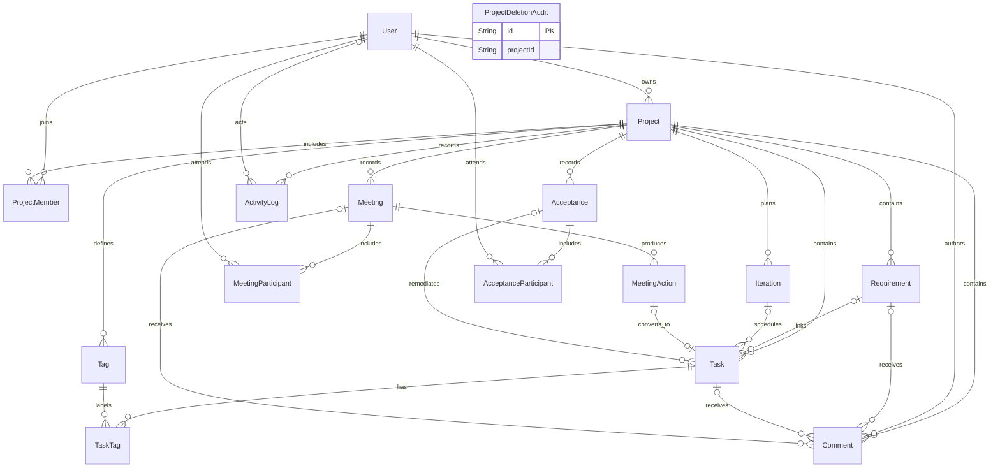

# 学生课程项目协作与进度管理系统数据库设计说明书

| 项目           | 内容                                                                    |
| -------------- | ----------------------------------------------------------------------- |
| 文档版本       | 1.1                                                                     |
| 编写日期       | 2026 年 11 月 14 日                                                     |
| 需求依据       | 《软件需求规格说明书》0.1.4                                             |
| 数据模型基线   | main `0932ae2` 与最终交付源码中的 `prisma/schema.prisma`；17模型、5迁移 |
| 数据库与访问层 | SQLite / Prisma 6.19.3                                                  |

## 本版更新

当前模型17个、标量字段134个、迁移5个。新增UserDisableAudit独立记录禁用审计；验收日期原本即可为空，本次修复无需Schema迁移。

本目录由原2026-11-12草稿修订，原D盘草稿保留。历史P0～P6记录仍绑定各自版本，不冒充本轮执行结果。

## 1. 设计范围与原则

数据库围绕用户、项目及过程资料建立关系模型，支撑 FR-01～FR-11。系统由 API 服务端统一访问 SQLite，客户端不直接读写数据库文件。模型及迁移是结构依据，字段合法值和跨项目业务约束由服务端共同实施。

本文列出实现基线中全部 17 个模型的标量字段、关联及索引。表中的类型为 Prisma 类型，不将其误写为 SQLite 的原生枚举或固定长度字符列。`?` 表示可空；`@default`、`@updatedAt` 等为 Schema 声明，实际建表与数据库约束以 Migration SQL 为准。

## 2. 数据模型总览

| 模型                    | 业务对象     | 对应范围            |
| ----------------------- | ------------ | ------------------- |
| `User`                  | 用户         | FR-01               |
| `Project`               | 项目         | FR-02               |
| `ProjectMember`         | 项目成员     | FR-03               |
| `Requirement`           | 需求         | FR-04               |
| `Task`                  | 任务         | FR-05、FR-09、FR-11 |
| `Tag`                   | 标签         | FR-05、FR-11        |
| `TaskTag`               | 任务标签关联 | FR-05、FR-11        |
| `Iteration`             | 迭代         | FR-06               |
| `Comment`               | 评论         | FR-07               |
| `ActivityLog`           | 操作记录     | FR-07、FR-10        |
| `ProjectDeletionAudit`  | 项目删除审计 | FR-02 的删除审计    |
| `UserDisableAudit`      | 用户禁用审计 | FR-01；字段见第9节  |
| `Meeting`               | 会议         | FR-08               |
| `MeetingParticipant`    | 会议参与人   | FR-08               |
| `MeetingAction`         | 会议行动项   | FR-08               |
| `Acceptance`            | 阶段验收     | FR-09               |
| `AcceptanceParticipant` | 验收参与人   | FR-09               |

## 3. 核心 ER 关系

评论通过对象类型及相应外键关联需求、任务或会议，“仅对应一个有效目标”由应用层校验。操作记录使用对象类型和对象 ID 定位目标，未为每种目标建立独立外键。删除审计保存快照，不与已删除项目建立外键。

## 4. 数据字典

### 4.1 User（用户）

| 字段              | Prisma 类型 | 可空 | Schema 规则与默认值                                    | 含义                         |
| ----------------- | ----------- | ---- | ------------------------------------------------------ | ---------------------------- |
| `id`              | `String`    | 否   | `@id @default(cuid())`                                 | 记录标识                     |
| `username`        | `String`    | 否   | `@unique`                                              | 用户名                       |
| `passwordHash`    | `String`    | 否   | 无额外字段声明                                         | 密码哈希，不返回普通业务接口 |
| `nickname`        | `String`    | 否   | 无额外字段声明                                         | 昵称                         |
| `avatarUrl`       | `String?`   | 是   | 无额外字段声明                                         | 头像存储引用或兼容资料值     |
| `status`          | `String`    | 否   | `@default("ACTIVE")`；限定值参见：`ACTIVE \| DISABLED` | 业务状态                     |
| `tokenVersion`    | `Int`       | 否   | `@default(0)`                                          | 会话令牌版本                 |
| `isPlatformAdmin` | `Boolean`   | 否   | `@default(false)`                                      | 平台管理员标识               |
| `createdAt`       | `DateTime`  | 否   | `@default(now())`                                      | 创建时间                     |
| `updatedAt`       | `DateTime`  | 否   | `@updatedAt`                                           | 更新时间                     |

### 4.2 Project（项目）

| 字段          | Prisma 类型 | 可空 | Schema 规则与默认值                                                                         | 含义               |
| ------------- | ----------- | ---- | ------------------------------------------------------------------------------------------- | ------------------ |
| `id`          | `String`    | 否   | `@id @default(cuid())`                                                                      | 记录标识           |
| `name`        | `String`    | 否   | 无额外字段声明                                                                              | 名称               |
| `description` | `String?`   | 是   | 无额外字段声明                                                                              | 说明               |
| `startDate`   | `DateTime?` | 是   | 无额外字段声明                                                                              | 开始日期           |
| `endDate`     | `DateTime?` | 是   | 无额外字段声明                                                                              | 结束日期           |
| `status`      | `String`    | 否   | `@default("PLANNING")`；限定值参见：`PLANNING \| ACTIVE \| PAUSED \| COMPLETED \| ARCHIVED` | 业务状态           |
| `ownerId`     | `String`    | 否   | 无额外字段声明                                                                              | 项目负责人用户标识 |
| `createdAt`   | `DateTime`  | 否   | `@default(now())`                                                                           | 创建时间           |
| `updatedAt`   | `DateTime`  | 否   | `@updatedAt`                                                                                | 更新时间           |

外键关联：

| 关系字段 | 目标模型 | 关系声明                                                                             |
| -------- | -------- | ------------------------------------------------------------------------------------ |
| `owner`  | `User`   | `@relation("ProjectOwner", fields: [ownerId], references: [id], onDelete: Restrict)` |

模型级约束与索引：

- `@@index([ownerId])`
- `@@index([status])`

### 4.3 ProjectMember（项目成员）

| 字段        | Prisma 类型 | 可空 | Schema 规则与默认值                                             | 含义         |
| ----------- | ----------- | ---- | --------------------------------------------------------------- | ------------ |
| `id`        | `String`    | 否   | `@id @default(cuid())`                                          | 记录标识     |
| `projectId` | `String`    | 否   | 无额外字段声明                                                  | 所属项目标识 |
| `userId`    | `String`    | 否   | 无额外字段声明                                                  | 用户标识     |
| `role`      | `String`    | 否   | `@default("MEMBER")`；限定值参见：`OWNER \| MEMBER \| OBSERVER` | 项目角色     |
| `joinedAt`  | `DateTime`  | 否   | `@default(now())`                                               | 加入时间     |

外键关联：

| 关系字段  | 目标模型  | 关系声明                                                              |
| --------- | --------- | --------------------------------------------------------------------- |
| `project` | `Project` | `@relation(fields: [projectId], references: [id], onDelete: Cascade)` |
| `user`    | `User`    | `@relation(fields: [userId], references: [id], onDelete: Restrict)`   |

模型级约束与索引：

- `@@unique([projectId, userId])`
- `@@index([userId])`
- `@@index([projectId, role])`

### 4.4 Requirement（需求）

| 字段                 | Prisma 类型 | 可空 | Schema 规则与默认值                                                                                                 | 含义               |
| -------------------- | ----------- | ---- | ------------------------------------------------------------------------------------------------------------------- | ------------------ |
| `id`                 | `String`    | 否   | `@id @default(cuid())`                                                                                              | 记录标识           |
| `projectId`          | `String`    | 否   | 无额外字段声明                                                                                                      | 所属项目标识       |
| `number`             | `String`    | 否   | 无额外字段声明                                                                                                      | 项目内需求编号     |
| `title`              | `String`    | 否   | 无额外字段声明                                                                                                      | 标题               |
| `description`        | `String?`   | 是   | 无额外字段声明                                                                                                      | 说明               |
| `priority`           | `String`    | 否   | `@default("MEDIUM")`；限定值参见：`HIGH \| MEDIUM \| LOW`                                                           | 优先级             |
| `acceptanceCriteria` | `String`    | 否   | 无额外字段声明                                                                                                      | 验收标准           |
| `status`             | `String`    | 否   | `@default("DRAFT")`；限定值参见：`DRAFT \| CONFIRMED \| IN_PROGRESS \| PENDING_ACCEPTANCE \| COMPLETED \| REJECTED` | 业务状态           |
| `creatorId`          | `String`    | 否   | 无额外字段声明                                                                                                      | 提出或创建用户标识 |
| `createdAt`          | `DateTime`  | 否   | `@default(now())`                                                                                                   | 创建时间           |
| `updatedAt`          | `DateTime`  | 否   | `@updatedAt`                                                                                                        | 更新时间           |

外键关联：

| 关系字段  | 目标模型  | 关系声明                                                                                     |
| --------- | --------- | -------------------------------------------------------------------------------------------- |
| `project` | `Project` | `@relation(fields: [projectId], references: [id], onDelete: Cascade)`                        |
| `creator` | `User`    | `@relation("RequirementCreator", fields: [creatorId], references: [id], onDelete: Restrict)` |

模型级约束与索引：

- `@@unique([projectId, number])`
- `@@index([projectId, status])`
- `@@index([creatorId])`

### 4.5 Task（任务）

| 字段             | Prisma 类型 | 可空 | Schema 规则与默认值                                                                                           | 含义           |
| ---------------- | ----------- | ---- | ------------------------------------------------------------------------------------------------------------- | -------------- |
| `id`             | `String`    | 否   | `@id @default(cuid())`                                                                                        | 记录标识       |
| `projectId`      | `String`    | 否   | 无额外字段声明                                                                                                | 所属项目标识   |
| `requirementId`  | `String?`   | 是   | 无额外字段声明                                                                                                | 关联需求标识   |
| `iterationId`    | `String?`   | 是   | 无额外字段声明                                                                                                | 关联迭代标识   |
| `acceptanceId`   | `String?`   | 是   | 无额外字段声明                                                                                                | 关联验收标识   |
| `createdById`    | `String`    | 否   | 无额外字段声明                                                                                                | 创建用户标识   |
| `assigneeId`     | `String?`   | 是   | 无额外字段声明                                                                                                | 负责人用户标识 |
| `title`          | `String`    | 否   | 无额外字段声明                                                                                                | 标题           |
| `description`    | `String?`   | 是   | 无额外字段声明                                                                                                | 说明           |
| `priority`       | `String`    | 否   | `@default("MEDIUM")`；限定值参见：`HIGH \| MEDIUM \| LOW`                                                     | 优先级         |
| `status`         | `String`    | 否   | `@default("BACKLOG")`；限定值参见：`BACKLOG \| TODO \| IN_PROGRESS \| PENDING_REVIEW \| COMPLETED \| BLOCKED` | 业务状态       |
| `dueDate`        | `DateTime?` | 是   | 无额外字段声明                                                                                                | 截止日期       |
| `estimatedHours` | `Float?`    | 是   | 无额外字段声明                                                                                                | 预估工时       |
| `completionNote` | `String?`   | 是   | 无额外字段声明                                                                                                | 完成说明       |
| `completedAt`    | `DateTime?` | 是   | 无额外字段声明                                                                                                | 完成时间       |
| `createdAt`      | `DateTime`  | 否   | `@default(now())`                                                                                             | 创建时间       |
| `updatedAt`      | `DateTime`  | 否   | `@updatedAt`                                                                                                  | 更新时间       |

外键关联：

| 关系字段      | 目标模型       | 关系声明                                                                                   |
| ------------- | -------------- | ------------------------------------------------------------------------------------------ |
| `project`     | `Project`      | `@relation(fields: [projectId], references: [id], onDelete: Cascade)`                      |
| `requirement` | `Requirement?` | `@relation(fields: [requirementId], references: [id], onDelete: SetNull)`                  |
| `iteration`   | `Iteration?`   | `@relation(fields: [iterationId], references: [id], onDelete: SetNull)`                    |
| `acceptance`  | `Acceptance?`  | `@relation("TaskAcceptance", fields: [acceptanceId], references: [id], onDelete: SetNull)` |
| `createdBy`   | `User`         | `@relation("TaskCreator", fields: [createdById], references: [id], onDelete: Restrict)`    |
| `assignee`    | `User?`        | `@relation("TaskAssignee", fields: [assigneeId], references: [id], onDelete: SetNull)`     |

模型级约束与索引：

- `@@index([projectId, status])`
- `@@index([requirementId])`
- `@@index([iterationId])`
- `@@index([acceptanceId])`
- `@@index([assigneeId])`
- `@@index([dueDate])`

### 4.6 Tag（标签）

| 字段        | Prisma 类型 | 可空 | Schema 规则与默认值    | 含义         |
| ----------- | ----------- | ---- | ---------------------- | ------------ |
| `id`        | `String`    | 否   | `@id @default(cuid())` | 记录标识     |
| `projectId` | `String`    | 否   | 无额外字段声明         | 所属项目标识 |
| `name`      | `String`    | 否   | 无额外字段声明         | 名称         |
| `color`     | `String`    | 否   | 无额外字段声明         | 标签颜色     |
| `createdAt` | `DateTime`  | 否   | `@default(now())`      | 创建时间     |

外键关联：

| 关系字段  | 目标模型  | 关系声明                                                              |
| --------- | --------- | --------------------------------------------------------------------- |
| `project` | `Project` | `@relation(fields: [projectId], references: [id], onDelete: Cascade)` |

模型级约束与索引：

- `@@unique([projectId, name])`
- `@@index([projectId])`

### 4.7 TaskTag（任务标签关联）

| 字段     | Prisma 类型 | 可空 | Schema 规则与默认值 | 含义     |
| -------- | ----------- | ---- | ------------------- | -------- |
| `taskId` | `String`    | 否   | 无额外字段声明      | 任务标识 |
| `tagId`  | `String`    | 否   | 无额外字段声明      | 标签标识 |

外键关联：

| 关系字段 | 目标模型 | 关系声明                                                           |
| -------- | -------- | ------------------------------------------------------------------ |
| `task`   | `Task`   | `@relation(fields: [taskId], references: [id], onDelete: Cascade)` |
| `tag`    | `Tag`    | `@relation(fields: [tagId], references: [id], onDelete: Cascade)`  |

模型级约束与索引：

- `@@id([taskId, tagId])`
- `@@index([tagId])`

### 4.8 Iteration（迭代）

| 字段        | Prisma 类型 | 可空 | Schema 规则与默认值                                                                          | 含义         |
| ----------- | ----------- | ---- | -------------------------------------------------------------------------------------------- | ------------ |
| `id`        | `String`    | 否   | `@id @default(cuid())`                                                                       | 记录标识     |
| `projectId` | `String`    | 否   | 无额外字段声明                                                                               | 所属项目标识 |
| `name`      | `String`    | 否   | 无额外字段声明                                                                               | 名称         |
| `goal`      | `String?`   | 是   | 无额外字段声明                                                                               | 目标         |
| `startDate` | `DateTime`  | 否   | 无额外字段声明                                                                               | 开始日期     |
| `endDate`   | `DateTime`  | 否   | 无额外字段声明                                                                               | 结束日期     |
| `status`    | `String`    | 否   | `@default("NOT_STARTED")`；限定值参见：`NOT_STARTED \| IN_PROGRESS \| COMPLETED \| CANCELED` | 业务状态     |
| `createdAt` | `DateTime`  | 否   | `@default(now())`                                                                            | 创建时间     |
| `updatedAt` | `DateTime`  | 否   | `@updatedAt`                                                                                 | 更新时间     |

外键关联：

| 关系字段  | 目标模型  | 关系声明                                                              |
| --------- | --------- | --------------------------------------------------------------------- |
| `project` | `Project` | `@relation(fields: [projectId], references: [id], onDelete: Cascade)` |

模型级约束与索引：

- `@@index([projectId, status])`
- `@@index([startDate, endDate])`

### 4.9 Comment（评论）

| 字段            | Prisma 类型 | 可空 | Schema 规则与默认值                                          | 含义         |
| --------------- | ----------- | ---- | ------------------------------------------------------------ | ------------ |
| `id`            | `String`    | 否   | `@id @default(cuid())`                                       | 记录标识     |
| `projectId`     | `String`    | 否   | 无额外字段声明                                               | 所属项目标识 |
| `targetType`    | `String`    | 否   | 无额外字段声明；限定值参见：`REQUIREMENT \| TASK \| MEETING` | 对象类型     |
| `requirementId` | `String?`   | 是   | 无额外字段声明                                               | 关联需求标识 |
| `taskId`        | `String?`   | 是   | 无额外字段声明                                               | 任务标识     |
| `meetingId`     | `String?`   | 是   | 无额外字段声明                                               | 会议标识     |
| `authorId`      | `String`    | 否   | 无额外字段声明                                               | 评论作者标识 |
| `content`       | `String`    | 否   | 无额外字段声明                                               | 评论内容     |
| `createdAt`     | `DateTime`  | 否   | `@default(now())`                                            | 创建时间     |
| `updatedAt`     | `DateTime`  | 否   | `@updatedAt`                                                 | 更新时间     |

外键关联：

| 关系字段      | 目标模型       | 关系声明                                                                  |
| ------------- | -------------- | ------------------------------------------------------------------------- |
| `project`     | `Project`      | `@relation(fields: [projectId], references: [id], onDelete: Cascade)`     |
| `requirement` | `Requirement?` | `@relation(fields: [requirementId], references: [id], onDelete: Cascade)` |
| `task`        | `Task?`        | `@relation(fields: [taskId], references: [id], onDelete: Cascade)`        |
| `meeting`     | `Meeting?`     | `@relation(fields: [meetingId], references: [id], onDelete: Cascade)`     |
| `author`      | `User`         | `@relation(fields: [authorId], references: [id], onDelete: Restrict)`     |

模型级约束与索引：

- `@@index([projectId, targetType])`
- `@@index([requirementId])`
- `@@index([taskId])`
- `@@index([meetingId])`
- `@@index([authorId])`

### 4.10 ActivityLog（操作记录）

| 字段          | Prisma 类型 | 可空 | Schema 规则与默认值    | 含义                 |
| ------------- | ----------- | ---- | ---------------------- | -------------------- |
| `id`          | `String`    | 否   | `@id @default(cuid())` | 记录标识             |
| `projectId`   | `String`    | 否   | 无额外字段声明         | 所属项目标识         |
| `actorId`     | `String?`   | 是   | 无额外字段声明         | 操作者标识           |
| `action`      | `String`    | 否   | 无额外字段声明         | 操作类型             |
| `targetType`  | `String`    | 否   | 无额外字段声明         | 对象类型             |
| `targetId`    | `String`    | 否   | 无额外字段声明         | 对象标识             |
| `beforeValue` | `String?`   | 是   | 无额外字段声明         | 修改前 JSON 快照文本 |
| `afterValue`  | `String?`   | 是   | 无额外字段声明         | 修改后 JSON 快照文本 |
| `createdAt`   | `DateTime`  | 否   | `@default(now())`      | 创建时间             |

外键关联：

| 关系字段  | 目标模型  | 关系声明                                                              |
| --------- | --------- | --------------------------------------------------------------------- |
| `project` | `Project` | `@relation(fields: [projectId], references: [id], onDelete: Cascade)` |
| `actor`   | `User?`   | `@relation(fields: [actorId], references: [id], onDelete: SetNull)`   |

模型级约束与索引：

- `@@index([projectId, createdAt])`
- `@@index([targetType, targetId])`
- `@@index([actorId])`

### 4.11 ProjectDeletionAudit（项目删除审计）

| 字段            | Prisma 类型 | 可空 | Schema 规则与默认值    | 含义                   |
| --------------- | ----------- | ---- | ---------------------- | ---------------------- |
| `id`            | `String`    | 否   | `@id @default(cuid())` | 记录标识               |
| `projectId`     | `String`    | 否   | 无额外字段声明         | 所属项目标识           |
| `projectName`   | `String`    | 否   | 无额外字段声明         | 删除时项目名快照       |
| `projectStatus` | `String`    | 否   | 无额外字段声明         | 删除时项目状态快照     |
| `actorId`       | `String`    | 否   | 无额外字段声明         | 操作者标识             |
| `actorUsername` | `String`    | 否   | 无额外字段声明         | 删除时操作者用户名快照 |
| `deletedAt`     | `DateTime`  | 否   | `@default(now())`      | 删除时间               |

模型级约束与索引：

- `@@index([projectId, deletedAt])`
- `@@index([actorId, deletedAt])`

### 4.12 Meeting（会议）

| 字段          | Prisma 类型 | 可空 | Schema 规则与默认值    | 含义         |
| ------------- | ----------- | ---- | ---------------------- | ------------ |
| `id`          | `String`    | 否   | `@id @default(cuid())` | 记录标识     |
| `projectId`   | `String`    | 否   | 无额外字段声明         | 所属项目标识 |
| `title`       | `String`    | 否   | 无额外字段声明         | 标题         |
| `scheduledAt` | `DateTime`  | 否   | 无额外字段声明         | 会议时间     |
| `agenda`      | `String?`   | 是   | 无额外字段声明         | 议程         |
| `minutes`     | `String?`   | 是   | 无额外字段声明         | 会议纪要     |
| `decisions`   | `String?`   | 是   | 无额外字段声明         | 会议决定     |
| `createdById` | `String`    | 否   | 无额外字段声明         | 创建用户标识 |
| `createdAt`   | `DateTime`  | 否   | `@default(now())`      | 创建时间     |
| `updatedAt`   | `DateTime`  | 否   | `@updatedAt`           | 更新时间     |

外键关联：

| 关系字段    | 目标模型  | 关系声明                                                                                   |
| ----------- | --------- | ------------------------------------------------------------------------------------------ |
| `project`   | `Project` | `@relation(fields: [projectId], references: [id], onDelete: Cascade)`                      |
| `createdBy` | `User`    | `@relation("MeetingCreator", fields: [createdById], references: [id], onDelete: Restrict)` |

模型级约束与索引：

- `@@index([projectId, scheduledAt])`
- `@@index([createdById])`

### 4.13 MeetingParticipant（会议参与人）

| 字段        | Prisma 类型 | 可空 | Schema 规则与默认值 | 含义     |
| ----------- | ----------- | ---- | ------------------- | -------- |
| `meetingId` | `String`    | 否   | 无额外字段声明      | 会议标识 |
| `userId`    | `String`    | 否   | 无额外字段声明      | 用户标识 |

外键关联：

| 关系字段  | 目标模型  | 关系声明                                                              |
| --------- | --------- | --------------------------------------------------------------------- |
| `meeting` | `Meeting` | `@relation(fields: [meetingId], references: [id], onDelete: Cascade)` |
| `user`    | `User`    | `@relation(fields: [userId], references: [id], onDelete: Restrict)`   |

模型级约束与索引：

- `@@id([meetingId, userId])`
- `@@index([userId])`

### 4.14 MeetingAction（会议行动项）

| 字段              | Prisma 类型 | 可空 | Schema 规则与默认值                                                                  | 含义                         |
| ----------------- | ----------- | ---- | ------------------------------------------------------------------------------------ | ---------------------------- |
| `id`              | `String`    | 否   | `@id @default(cuid())`                                                               | 记录标识                     |
| `meetingId`       | `String`    | 否   | 无额外字段声明                                                                       | 会议标识                     |
| `assigneeId`      | `String?`   | 是   | 无额外字段声明                                                                       | 负责人用户标识               |
| `convertedTaskId` | `String?`   | 是   | `@unique`                                                                            | 已转换任务标识，具有唯一约束 |
| `title`           | `String`    | 否   | 无额外字段声明                                                                       | 标题                         |
| `dueDate`         | `DateTime?` | 是   | 无额外字段声明                                                                       | 截止日期                     |
| `status`          | `String`    | 否   | `@default("PENDING")`；限定值参见：`PENDING \| IN_PROGRESS \| COMPLETED \| CANCELED` | 业务状态                     |
| `createdAt`       | `DateTime`  | 否   | `@default(now())`                                                                    | 创建时间                     |
| `updatedAt`       | `DateTime`  | 否   | `@updatedAt`                                                                         | 更新时间                     |

外键关联：

| 关系字段        | 目标模型  | 关系声明                                                                                        |
| --------------- | --------- | ----------------------------------------------------------------------------------------------- |
| `meeting`       | `Meeting` | `@relation(fields: [meetingId], references: [id], onDelete: Cascade)`                           |
| `assignee`      | `User?`   | `@relation("MeetingActionAssignee", fields: [assigneeId], references: [id], onDelete: SetNull)` |
| `convertedTask` | `Task?`   | `@relation(fields: [convertedTaskId], references: [id], onDelete: SetNull)`                     |

模型级约束与索引：

- `@@index([meetingId, status])`
- `@@index([assigneeId])`
- `@@index([dueDate])`

### 4.15 Acceptance（阶段验收）

| 字段             | Prisma 类型 | 可空 | Schema 规则与默认值                                                                     | 含义         |
| ---------------- | ----------- | ---- | --------------------------------------------------------------------------------------- | ------------ |
| `id`             | `String`    | 否   | `@id @default(cuid())`                                                                  | 记录标识     |
| `projectId`      | `String`    | 否   | 无额外字段声明                                                                          | 所属项目标识 |
| `stageName`      | `String`    | 否   | 无额外字段声明                                                                          | 验收阶段名称 |
| `goal`           | `String?`   | 是   | 无额外字段声明                                                                          | 目标         |
| `acceptanceDate` | `DateTime?` | 是   | 无额外字段声明                                                                          | 验收日期     |
| `standards`      | `String`    | 否   | 无额外字段声明                                                                          | 验收标准     |
| `result`         | `String`    | 否   | `@default("NOT_STARTED")`；限定值参见：`NOT_STARTED \| IN_PROGRESS \| PASSED \| FAILED` | 验收结果     |
| `failureReason`  | `String?`   | 是   | 无额外字段声明                                                                          | 未通过原因   |
| `createdById`    | `String`    | 否   | 无额外字段声明                                                                          | 创建用户标识 |
| `createdAt`      | `DateTime`  | 否   | `@default(now())`                                                                       | 创建时间     |
| `updatedAt`      | `DateTime`  | 否   | `@updatedAt`                                                                            | 更新时间     |

外键关联：

| 关系字段    | 目标模型  | 关系声明                                                                                      |
| ----------- | --------- | --------------------------------------------------------------------------------------------- |
| `project`   | `Project` | `@relation(fields: [projectId], references: [id], onDelete: Cascade)`                         |
| `createdBy` | `User`    | `@relation("AcceptanceCreator", fields: [createdById], references: [id], onDelete: Restrict)` |

模型级约束与索引：

- `@@index([projectId, acceptanceDate])`
- `@@index([createdById])`
- `@@index([result])`

### 4.16 AcceptanceParticipant（验收参与人）

| 字段           | Prisma 类型 | 可空 | Schema 规则与默认值 | 含义         |
| -------------- | ----------- | ---- | ------------------- | ------------ |
| `acceptanceId` | `String`    | 否   | 无额外字段声明      | 关联验收标识 |
| `userId`       | `String`    | 否   | 无额外字段声明      | 用户标识     |

外键关联：

| 关系字段     | 目标模型     | 关系声明                                                                 |
| ------------ | ------------ | ------------------------------------------------------------------------ |
| `acceptance` | `Acceptance` | `@relation(fields: [acceptanceId], references: [id], onDelete: Cascade)` |
| `user`       | `User`       | `@relation(fields: [userId], references: [id], onDelete: Restrict)`      |

模型级约束与索引：

- `@@id([acceptanceId, userId])`
- `@@index([userId])`

## 5. 状态、关联与数据一致性

### 5.1 限定值

| 数据       | 允许值                                                                 |
| ---------- | ---------------------------------------------------------------------- |
| 用户状态   | ACTIVE、DISABLED                                                       |
| 项目状态   | PLANNING、ACTIVE、PAUSED、COMPLETED、ARCHIVED                          |
| 项目角色   | OWNER、MEMBER、OBSERVER；平台管理员另用布尔标识                        |
| 需求状态   | DRAFT、CONFIRMED、IN_PROGRESS、PENDING_ACCEPTANCE、COMPLETED、REJECTED |
| 任务状态   | BACKLOG、TODO、IN_PROGRESS、PENDING_REVIEW、COMPLETED、BLOCKED         |
| 优先级     | HIGH、MEDIUM、LOW                                                      |
| 迭代状态   | NOT_STARTED、IN_PROGRESS、COMPLETED、CANCELED                          |
| 评论目标   | REQUIREMENT、TASK、MEETING                                             |
| 行动项状态 | PENDING、IN_PROGRESS、COMPLETED、CANCELED                              |
| 验收结果   | NOT_STARTED、IN_PROGRESS、PASSED、FAILED                               |

这些值在当前 SQLite 模型中是字符串，由 DTO 和 Service 校验；允许值也不表示任意两个状态之间都能直接流转。

### 5.2 关键约束

1. 项目成员关系在项目与用户范围内唯一；负责人移交同时维护 Project.ownerId 和成员角色。
2. 任务关联的需求、迭代、验收及负责人需属于同一项目；任务截止日期不能早于项目开始日期。
3. 需求编号、标签名分别在项目内唯一。评论校验目标归属，修改、删除评论检查作者权限。
4. 业务写入重新检查项目状态、账号和权限。归档只读，暂停禁止新增业务数据。
5. 任务状态变更、完成时间及操作快照共同写入事务；并发更新使用预期原状态作为条件。
6. 行动项转换先检查未转换状态，并在事务中创建任务、条件更新引用及保存日志。唯一约束与条件更新共同防止重复转换。
7. 删除任务前保存必要快照，历史完成及燃尽分析可以读取删除前的状态事件；当前汇总仍只计算现存任务。

## 6. 删除、历史与文件数据

Schema 使用 Cascade、SetNull 和 Restrict 处理不同关系。删除项目会处理项目内关联数据，删除审计另存独立快照；移除成员仅改变成员关系，不等同于删除用户，历史评论和操作记录仍保留。

头像图片位于服务端受控目录，User.avatarUrl 保存 `uploaded:` 引用，接口按需要将其转换为 Data URL。数据库和文件系统通过失败补偿衔接，不具备跨资源事务。文件名、存储路径及内容校验由服务端管理。

验收日期字段可空。PATCH中省略acceptanceDate保留原值，传null清空，合法日期替换；创建时空日期省略。其他字段仍以各DTO和Service的明确语义为准。

## 7. 迁移与维护

| Migration                                  | 作用               |
| ------------------------------------------ | ------------------ |
| `20260927150705_init`                      | 初始化核心关系模型 |
| `20261013142942_p1_auth_session`           | 认证会话相关结构   |
| `20261021145500_p2_project_permissions`    | 项目权限相关结构   |
| `20261025000000_p2_project_deletion_audit` | 独立项目删除审计   |
| `20261112090000_user_disable_audit`        | 独立用户禁用审计   |

结构变更必须通过 Prisma Migration，不手工修改运行库。`DATABASE_URL` 默认相对于 Schema 解析为 `file:../data/app.db`；真实数据文件不进入源码提交，测试使用隔离数据库。

迁移、备份和恢复须结合部署版本、数据库与头像目录处理。FR-14 的系统内备份恢复仍是建议功能，本文不把数据维护要求写成已提供的产品入口。涉及不可逆数据变更时按项目规则评估恢复方案。

## 8. 关联资料与验证边界

- [技术架构书](技术架构书.md)：分层、事务、认证和文件存储边界。
- [API 接口说明书](API接口说明书.md)：请求字段、返回类型及接口约束。
- [正式需求基线](../需求规格说明书.md)：数据要求和业务规则。

本文的数据字典与固定版本 Schema 对照整理，不读取或展示实际用户数据、密码哈希值、令牌或本地运行库。P7 如发生结构或契约调整，应同步更新模型基线、字典和对应迁移说明。

## 9. UserDisableAudit最终增补

| 字段         | 类型     | 约束/意义      |
| ------------ | -------- | -------------- |
| id           | String   | CUID主键       |
| actorId      | String   | 操作者标识     |
| targetUserId | String   | 被禁用用户标识 |
| beforeStatus | String   | 操作前账号状态 |
| afterStatus  | String   | 操作后账号状态 |
| createdAt    | DateTime | 默认当前时间   |

索引为(targetUserId,createdAt)和(actorId,createdAt)。actorId/targetUserId为审计标识，Schema未建立外键关系，不将其画成已实现的外键约束。新增迁移`20261112090000_user_disable_audit`只创建审计表和索引。前四个迁移不改；全部5迁移在空库、旧库升级和重复部署中验证。

最终状态与结果：[最终测试报告](最终测试报告.md)、[项目验收报告](项目验收报告.md)、[最终交付清单](最终交付清单.md)。
