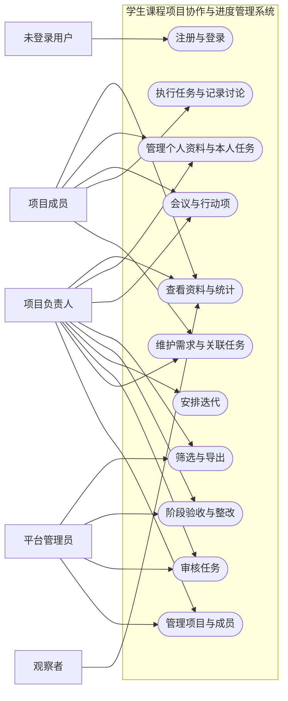

# 学生课程项目协作与进度管理系统用例设计说明书

| 项目     | 内容                                                   |
| -------- | ------------------------------------------------------ |
| 文档版本 | 1.1                                                    |
| 编写日期 | 2026 年 11 月 14 日                                    |
| 需求依据 | 《软件需求规格说明书》0.1.4                            |
| 实现参考 | P6 业务版本 `db6593c350fde0ea106a4dfbad02dd6db3d3610f` |
| 文档用途 | 记录用户故事、参与者、核心用例及需求追溯               |

## 本版更新

本版核心用例已由最终业务回归覆盖；组长人工体验为可选补充，不作为技术验收前置。

本目录由原2026-11-12草稿修订，原D盘草稿保留。历史P0～P6记录仍绑定各自版本，不冒充本轮执行结果。

## 1. 设计范围

本文围绕 FR-01～FR-11 的必做功能描述用户目标和交互过程。UC、US 编号只用于本文的用例和用户故事，不新增正式 FR 或 AC，也不代表相应场景已通过最终验收。最终测试结果已记入《最终测试报告》。

## 2. 参与者

| 参与者     | 作用及权限边界                                             |
| ---------- | ---------------------------------------------------------- |
| 平台管理员 | 管理平台账号与基础数据，可跨项目执行获准的管理操作         |
| 项目负责人 | 管理项目、成员、需求、迭代与验收，审核任务并导出资料       |
| 项目成员   | 在已加入项目内维护获准的需求和任务，参与评论、会议及行动项 |
| 观察者     | 在已加入项目内只读查看资料、进度及验收结果                 |
| 未登录用户 | 注册和登录；不能读取受保护的项目数据                       |

项目成员更新任务状态时仍须遵循审核规则，不能因具备状态更新权限就代替负责人审核完成任务。管理员属于平台权限，OWNER、MEMBER、OBSERVER 属于项目角色。

## 3. 用户故事

| 编号  | 用户故事                                                                       | 对应需求与验收                              |
| ----- | ------------------------------------------------------------------------------ | ------------------------------------------- |
| US-01 | 作为用户，我希望注册并安全登录系统，以便使用自己的账号参与项目                 | FR-01；AC-01                                |
| US-02 | 作为用户，我希望独立保存昵称和头像，以便更新资料时不丢失尚未保存的内容         | FR-01；AC-11                                |
| US-03 | 作为负责人，我希望创建项目并邀请成员，以便在统一空间明确协作角色               | FR-02、FR-03；AC-02、AC-08                  |
| US-04 | 作为团队成员，我希望将需求与多个任务关联，以便核对需求是否落实                 | FR-04、FR-05；AC-03                         |
| US-05 | 作为任务负责人，我希望更新进展、提交成果说明并接受审核，以便完成事项有明确依据 | FR-05、FR-07；AC-04                         |
| US-06 | 作为项目负责人，我希望安排迭代并查看完成率，以便组织阶段工作                   | FR-06；AC-05                                |
| US-07 | 作为成员，我希望在业务事项下讨论并回查操作记录，以便了解变更背景               | FR-07；相关 AC-04、AC-08                    |
| US-08 | 作为会议参与者，我希望将决定登记为行动项并转换任务，以便跟进会后工作           | FR-08；AC-06                                |
| US-09 | 作为负责人，我希望记录验收和整改结果，以便未通过事项能够继续追踪               | FR-09；AC-07                                |
| US-10 | 作为负责人，我希望查看统计并筛选、导出任务，以便准备课程汇报                   | FR-10、FR-11；AC-09、AC-10 及基线第 6.10 节 |
| US-11 | 作为观察者，我希望查看项目过程和成果，以便在只读权限下了解团队进度             | FR-03 及相关业务；AC-08                     |

## 4. 用例关系图

下图按用户目标合并展示主要用例，细分操作及权限以第 5 节和需求基线为准。

这是以 Mermaid 绘制的功能关联图，不采用完整 UML `include` / `extend` 语义。管理员和负责人也可执行其权限内的日常业务，图中不重复绘制全部连线；观察者可管理个人账号资料，但对项目业务保持只读。

## 5. 核心用例说明

### 5.1 UC-01 注册与登录

- 参与者：未登录用户。
- 前置条件：客户端能够连接 API；注册用户名尚未被使用。
- 主流程：用户填写用户名、昵称和密码完成注册；返回登录入口后输入账号密码；系统验证凭据并进入项目中心。
- 后置条件：建立有效会话，受保护请求携带访问令牌。
- 异常流程：重复用户名、无效输入或错误密码显示明确提示；会话过期或账号被禁用时阻止继续访问。
- 对应需求：FR-01；AC-01、AC-10。

### 5.2 UC-02 修改个人资料与头像

- 参与者：已登录用户。
- 前置条件：当前会话有效。
- 主流程：用户编辑昵称；通过更换图片或相机入口选择有效图片；系统读取并自动上传一次，更新头像预览；用户另行保存昵称。
- 后置条件：头像和昵称独立保存，刷新或重新登录后可读取更新后的资料。
- 边界与异常：取消选图不上传；超限、格式不符、读取或上传失败时保留原头像；头像上传不提交或丢弃未保存昵称，冲突操作期间限制再次提交。
- 对应需求：FR-01；AC-11。

### 5.3 UC-03 创建项目与配置成员

- 参与者：项目负责人或平台管理员。
- 前置条件：用户具备创建及管理权限，待邀请用户已注册。
- 主流程：填写项目名称、说明和计划日期；创建项目；邀请已有用户并设置成员或观察者角色；成员登录后查看加入的项目。
- 后置条件：项目、负责人及成员关系保存，成员按角色访问项目。
- 边界与异常：结束日期早于开始日期时拒绝；未加入项目不能读取内部数据；负责人移除自己前先移交负责人权限；移除成员后保留历史记录。
- 对应需求：FR-02、FR-03；AC-02、AC-08、AC-10。

### 5.4 UC-04 需求拆分与任务安排

- 参与者：已加入项目且有写入权限的用户。
- 前置条件：项目允许新增业务数据。
- 主流程：创建需求并填写标准、优先级；创建多个任务并关联需求；设置负责人、截止日期和标签；按计划将任务加入迭代。
- 后置条件：需求详情显示关联任务，任务具有明确的项目归属和执行信息。
- 边界与异常：需求标题及标准不能为空；负责人和关联对象属于当前项目；任务截止日期不能早于项目开始日期；暂停时禁止新增，归档后只读。
- 对应需求：FR-04～FR-06；AC-03、AC-05、AC-10。

### 5.5 UC-05 执行、审核与重新打开任务

- 参与者：项目成员、项目负责人或管理员。
- 前置条件：任务存在，操作者具备相应权限，项目允许本次写入。
- 主流程：待规划任务移至待开始；成员开始处理并更新为进行中；填写完成说明后提交审核；负责人审核通过后完成任务。
- 后置条件：保存状态、完成时间及操作记录。
- 分支流程：任务阻塞后可恢复处理；审核不通过时保持待审核并显示原因；已完成任务可填写原因后重新打开。
- 异常流程：没有说明、越权审核、非法跳转或并发状态变化时拒绝或提示刷新，不覆盖其他用户的新状态。
- 对应需求：FR-05、FR-07；AC-04、AC-08、AC-10。

### 5.6 UC-06 迭代计划与评论

- 参与者：负责人管理迭代；有权限的项目用户参与评论。
- 前置条件：项目可访问，写入满足项目状态及角色要求。
- 主流程：负责人创建迭代，安排任务并查看统计；成员在需求、任务或会议下发表评论；本人可编辑、删除自己的评论；迭代关闭时按需要处理未完成任务。
- 后置条件：迭代任务归属、统计及讨论内容可查询，相关操作留痕。
- 边界与异常：空迭代能显示合理统计；跨项目任务或已变化的迭代归属拒绝操作；不能修改、删除他人评论，观察者不能发布评论。
- 对应需求：FR-06、FR-07；AC-05、AC-08、AC-10。

### 5.7 UC-07 会议行动项转任务

- 参与者：具备会议写入权限的项目用户。
- 前置条件：会议及行动项属于当前项目，行动项尚未转换。
- 主流程：创建会议并记录参会人员、议程、纪要和决定；建立行动项，指定负责人、日期和状态；按需要转换为任务并继续安排。
- 后置条件：行动项与转换任务保留关联，会议来源可回查。
- 边界与异常：负责人、需求和日期均需校验；已转换行动项不能重复转换；转换失败不留下该次新建的孤立任务；后续加入迭代失败应重试已有任务的后续步骤。
- 对应需求：FR-08、FR-05；AC-06、AC-10。

### 5.8 UC-08 阶段验收与整改

- 参与者：负责人或管理员；其他项目用户按权限查看。
- 前置条件：具备验收管理权限，已有阶段目标和标准。
- 主流程：建立验收记录，填写阶段、标准、参与人及结果；未通过时记录原因，创建关联整改任务；整改完成后再次记录验收结果。
- 后置条件：验收结果、整改来源和任务处理过程可追溯。
- 边界与异常：未通过原因缺失或无管理权限时拒绝；整改创建后加入迭代失败可继续恢复；处理中限制冲突切换，避免任务或反馈显示到另一条验收下。
- 对应需求：FR-09、FR-05；AC-07、AC-08、AC-10。

### 5.9 UC-09 查询统计与导出

- 参与者：已加入项目的用户；导出要求负责人或管理员权限。
- 前置条件：项目可读取。
- 主流程：查看概览及图表；组合标题、负责人、状态、优先级、标签、迭代和日期筛选任务；清空筛选；有权限者导出任务 CSV 或基础项目进度报告。
- 后置条件：结果与所用筛选、统计口径一致，文件可下载。
- 边界与异常：空项目和无结果有明确反馈；无效日期、请求失败和无权限导出不造成程序崩溃；旧筛选响应不覆盖新结果。
- 对应需求：FR-10、FR-11；AC-09、AC-10；图表全范围另对照基线第 6.10 节。

## 6. 共用业务规则

所有项目用例均需遵循项目隔离和角色权限。项目暂停禁止新增业务数据，归档禁止业务写入；未登录、失效会话和被禁用账号不能继续访问受保护数据。前端入口隐藏或按钮禁用不能代替服务端检查。

附件、GitHub Issue 关联、系统内备份恢复以及高级报表不作为上述核心用例的必备前置条件。头像上传属于 FR-01 的必做能力，与 FR-12 的通用附件功能分别管理。

## 7. 关联资料

- [用户需求分析书](用户需求分析书.md)：角色、场景及正式 AC 对应表。
- [技术架构书](技术架构书.md)：调用链路、事务及安全边界。
- [测试计划与阶段验证汇总](测试计划与阶段验证汇总.md)：历史阶段来源与最终验证结果。
- [正式需求基线](../需求规格说明书.md)：功能、业务规则及完整验收条文。

## 8. 管理员禁用用例补充

UC-10，关联FR-01、AC-01/08/10。平台管理员进入用户管理，输入目标用户名确认后禁用普通用户。目标旧会话失效、后续登录拒绝；原任务和历史记录保留。取消或请求失败不改变状态；重复请求不重复写审计；管理员账号受保护，其他角色越权被拒绝。

最终状态与结果：[最终测试报告](最终测试报告.md)、[项目验收报告](项目验收报告.md)、[最终交付清单](最终交付清单.md)。
