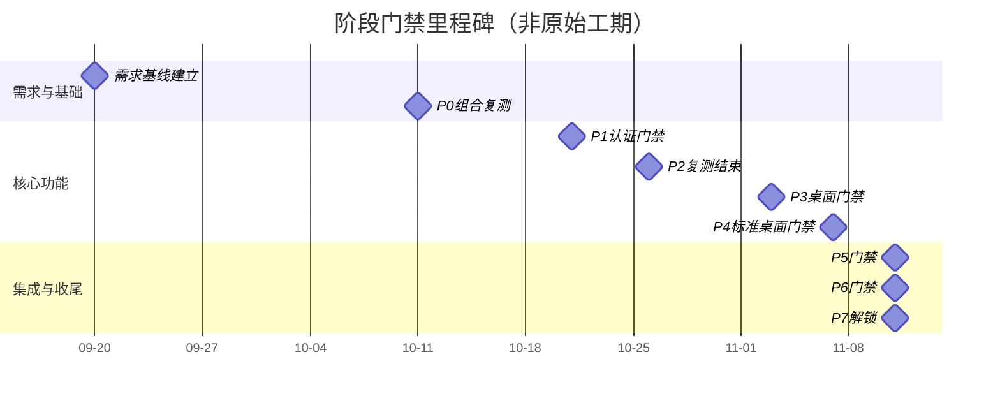

# 学生课程项目协作与进度管理系统项目计划与迭代记录

| 项目         | 内容                                                           |
| ------------ | -------------------------------------------------------------- |
| 文档版本     | 1.1                                                            |
| 编写日期     | 2026 年 11 月 14 日                                            |
| 需求依据     | 《软件需求规格说明书》0.1.4                                    |
| 计划依据     | T-01 后端、T-02 前端、T-03 测试任务中的 P0～P7 阶段定义        |
| 过程资料基线 | 含 P7 解锁记录的 `e6c6460`；业务源码对应 P6 合并版本 `db6593c` |

## 本版更新

当前技术收尾已执行；最终产物与结果见《最终交付清单》《最终测试报告》。个人贡献与原始工期不编造，组长补充体验不作为技术收尾的前置。

本目录由原2026-11-12草稿修订，原D盘草稿保留。历史P0～P6记录仍绑定各自版本，不冒充本轮执行结果。

## 1. 项目范围与计划原则

项目首版规划周期为 8～10 周，开发团队规模为三人，覆盖 FR-01～FR-11 的核心协作流程。FR-12～FR-14 为 S 级建议功能，FR-15 为 C 级扩展，未因编写结项材料而自动进入开发范围。

本文件将既有任务分解、可核实的阶段门禁及复盘信息集中展示。原始资料未提供的逐日工时、成员工作量和初始条形工期不予补造；第 4 节甘特表示门禁里程碑，不冒充原始排期或实际开发持续时间。

## 2. WBS 与责任分工

### 2.1 工作分解结构

| WBS | 阶段          | 主要工作包                                                        | 关联需求                          | 交付检查点                             |
| --- | ------------- | ----------------------------------------------------------------- | --------------------------------- | -------------------------------------- |
| 1   | P0 工程与契约 | workspace、运行环境、客户端骨架、API 入口、Schema、迁移、共享约定 | 为全部核心需求提供基础            | 工程可启动，契约与基础检查可运行       |
| 2   | P1 用户认证   | 注册登录、会话、个人资料、本人任务及后续确认的头像自动上传        | FR-01；AC-01、AC-11、相关 AC-10   | 身份、旧令牌、资料与头像流程           |
| 3   | P2 项目与权限 | 项目生命周期、邀请、角色、负责人移交、访问隔离                    | FR-02、FR-03；AC-02、AC-08        | 成员权限、暂停恢复、归档与删除保护     |
| 4   | P3 需求与任务 | 需求标准、任务分解、负责人日期标签、看板审核及状态记录            | FR-04、FR-05、FR-07；AC-03、AC-04 | 需求与任务关联，执行审核可追溯         |
| 5   | P4 迭代与评论 | 迭代目标、任务安排及迁移、统计、评论及操作记录                    | FR-06、FR-07；AC-05               | 迭代统计正确，评论权限有效             |
| 6   | P5 会议与验收 | 会议纪要、行动项及转换、验收、整改与再次验收                      | FR-08、FR-09；AC-06、AC-07        | 来源与整改可追踪，失败重试保持一致     |
| 7   | P6 统计与导出 | 仪表盘、趋势与燃尽、组合筛选、CSV 及基础进度报告                  | FR-10、FR-11；AC-09、AC-10        | 指标、筛选与实际文件内容一致           |
| 8   | P7 最终回归   | 完整核心流程、角色矩阵、数据隔离、输入及异常安全、最终报告        | 全部 M 功能；AC-01～AC-11         | 全部必做项有可核实结论，遗留有处理决定 |

### 2.2 执行职责

| 责任范围   | 既有任务                   | 主要交付职责                                       |
| ---------- | -------------------------- | -------------------------------------------------- |
| 后端与契约 | T-01                       | API、数据模型、授权、事务、共享类型及相关测试      |
| 桌面与交互 | T-02                       | 页面、业务交互、接口接入、加载与失败反馈及相关测试 |
| 测试与门禁 | T-03                       | 正常、边界、失败测试，证据汇总及阶段检查           |
| 项目统筹   | 项目负责人及 root 协作机制 | 需求范围、接口协调、评审、阶段决策和交付资料       |

这里记录的是项目既有工作责任，不等同于课程成员实际贡献量统计。个人贡献及署名应依据真实分工和周报填写。

## 3. 阶段依赖与推进方式

```text
P0 工程契约
  → P1 认证
  → P2 项目与权限
  → P3 需求与任务
  → P4 迭代与评论
  → P5 会议与验收
  → P6 统计与导出
  → P7 完整回归与最终报告
```

每阶段由 T-01 和 T-02 完成各自范围并标记待测试，随后冻结实现，由 T-03 统一检查。发现失败时保留证据，仅修复当前获准范围；复测通过并得到既有规则要求的阶段确认后，再进入下一阶段。

统计依赖完整的任务及历史记录，会议与验收依赖任务关联能力，最终回归依赖前面各阶段集成。阶段通过不能替代后续完整回归，也不自动授权 S/C 功能或发布部署。

## 4. 可核实的阶段里程碑

| 日期           | 里程碑                       | 记录所支持的状态                                     |
| -------------- | ---------------------------- | ---------------------------------------------------- |
| 2026-09-20     | 建立并确认首批需求与工程约定 | 需求基线及任务分解形成                               |
| 2026-10-11     | P0-R1 桌面与后端组合检查     | P0 组合候选通过完整基础检查                          |
| 2026-10-21     | P1 最终门禁                  | 认证及头像流程通过，按授权解锁 P2                    |
| 2026-10-25～26 | P2 R1 复测                   | 项目、成员、隔离及前端访问检查通过，保留当轮环境边界 |
| 2026-11-03     | P3 完整 Electron 验收        | 需求、任务和状态流程通过，P4 解锁                    |
| 2026-11-07     | P4 标准桌面复测              | 迭代、评论及统计通过，标准沙箱验证后进入 P5          |
| 2026-11-11     | P5 修复与门禁                | 验收创建并发问题修复并复测，按确认进入 P6            |
| 2026-11-11     | P6 统计、筛选及导出门禁      | 前后端合并，固定业务基线 `db6593c`                   |
| 2026-11-11     | P7 解锁                      | 开放既有最终回归及报告工作，不能记为最终验收已通过   |



图中同日里程碑不表示同一天完成了全部阶段开发。原图记录截至P7解锁的历史节点；最终技术收尾于2026-11-14执行，结果见最终测试及交付清单。

## 5. 迭代记录与复盘

| 阶段 | 计划与已记录成果           | 过程问题及处理                                               | 复盘要点                                       |
| ---- | -------------------------- | ------------------------------------------------------------ | ---------------------------------------------- |
| P0   | 建立工程、契约和可验证入口 | 通过组合复测检查前后端基础兼容及断网反馈                     | 先统一目录、启动与契约，再逐步接入业务         |
| P1   | 注册登录、会话、资料与头像 | 头像条件更新、上传边界、解码及响应读取竞态经修复回归         | 身份和文件流程应验证失败回退及跨客户端行为     |
| P2   | 项目、成员与角色           | 负责人移交并发、访问路由归属、未保存表单归档问题经修复       | 权限检查要绑定当前对象，状态变更不能丢弃草稿   |
| P3   | 需求、任务、审核与日志     | 完整桌面验收修正运行环境和验收工具问题，保留失败记录         | 工具运行失败与产品业务失败要分开说明           |
| P4   | 迭代、评论和组合统计       | 初始标准桌面启动失败，换用项目实际运行文件后标准沙箱复测通过 | 诊断用例通过不能代替标准运行模式验收           |
| P5   | 会议转换与整改验收         | 创建验收曾绕过整改期间的切换锁，修复后补齐双向并发保护       | 事务一致性和界面当前对象归属都需检查           |
| P6   | 仪表盘、筛选、历史与 CSV   | 修正业务日筛选、历史删除事件、聚合性能和筛选响应竞态         | 统计需核对明细与历史，旧请求不能覆盖新条件     |
| P7   | 完整回归与最终报告         | 本地最终技术回归与交付验证完成                               | 保留失败复测链路，结论见最终测试与技术验收报告 |

这些复盘依据阶段记录整理，不追加未发生的团队讨论或成员评价。历史环境问题的后续变化以较晚阶段记录为准，例如 P2 当轮的迁移 CLI 限制不能覆盖 P3 已记录的真实迁移成功结果。

## 6. 需求变更与范围控制

需求版本从 0.1.0 演进至 0.1.4。2026-10-20～21 围绕头像文件选择、服务端存储、移除 URL 输入、自动上传及昵称独立保存细化 FR-01，并增加、完善 AC-11；相关变更未扩大通用附件等扩展范围。

项目的 S/C 功能仍按既有优先级管理，P7 修复仅处理已确认核心问题。每次需求、接口或结构变更需要同步相关文档，阶段通过与最终发布分开决策。

## 7. 收尾工作

| 工作                           | 最终技术状态                                 |
| ------------------------------ | -------------------------------------------- |
| 核心MVP、权限及安全回归        | 已执行；结果见最终测试报告                   |
| 万任务看板、等待竞争及体验限制 | 已修复并复测                                 |
| 用户手册、部署说明及结项正文   | 本目录完整交付                               |
| 源码、文档与便携包             | 已生成，运行及完整性核验见最终交付清单       |
| 组长人工体验                   | 可选补充，不影响root技术完成结论             |
| 历史资料及个人贡献             | 原始资料保留，不编造成员贡献、工时或课程签字 |

## 8. 资料来源

- [需求基线](../需求规格说明书.md)及[用户需求分析书](用户需求分析书.md)。
- T-01、T-02、T-03 在 `e6c6460` 版本的阶段定义与进度记录；原项目目录中同名任务文件可能较旧。
- P0～P6 门禁报告来源与测试边界见[测试计划与阶段验证汇总](测试计划与阶段验证汇总.md)。
- [已有周报目录](../weekly-reports/)保存原始过程附件；本文件不把其中所有内容视为已经独立核实的最终贡献统计。

最终状态与结果：[最终测试报告](最终测试报告.md)、[项目验收报告](项目验收报告.md)、[最终交付清单](最终交付清单.md)。
